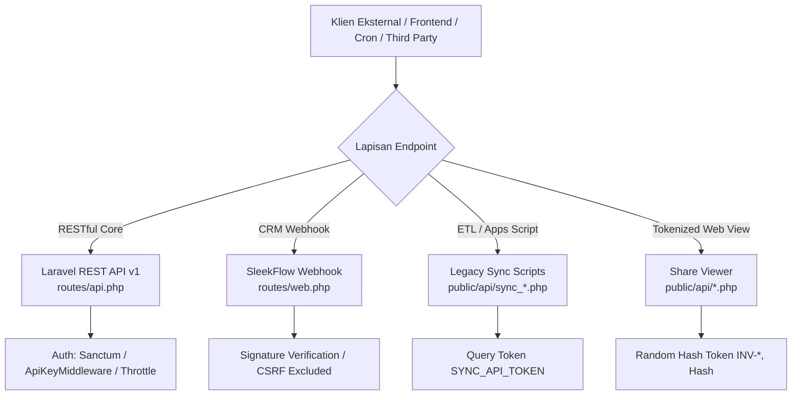

# 📘 Dokumentasi Resmi & Spesifikasi Lengkap API Sistem Workshop

**Versi Dokumen:** 1.0  
**Tanggal Rilis:** Jumat, 9 Oktober 2026  
**Standar Arsitektur:** Big 4 Enterprise Integration Standard  
**Basis Framework:** Laravel 11.x (PHP 8.2+)  

---

## 📌 Daftar Isi
1. [Arsitektur & Klasifikasi Endpoint API](#1-arsitektur--klasifikasi-endpoint-api)
2. [Standar Autentikasi & Keamanan](#2-standar-autentikasi--keamanan)
3. [Kelompok 1: Laravel REST API v1 (`routes/api.php`)](#3-kelompok-1-laravel-rest-api-v1-routesapiphp)
   - 3.1 [Autentikasi & Profil Pengguna](#31-autentikasi--profil-pengguna)
   - 3.2 [Modul Metrik KPI Divisi (`/api/v1/kpi/*`)](#32-modul-metrik-kpi-divisi-apiv1kpi)
   - 3.3 [Endpoint Pelanggan & Publik (`/api/v1/public/*`)](#33-endpoint-pelanggan--publik-apiv1public)
   - 3.4 [Webhook Masuk Finlog (`/api/v1/webhooks/*`)](#34-webhook-masuk-finlog-apiv1webhooks)
   - 3.5 [Portal Pelanggan Eksternal (`/api/v1/customer-portal/*`)](#35-portal-pelanggan-eksternal-apiv1customer-portal)
   - 3.6 [Dashboard & Metrik Ringkasan (`/api/v1/dashboard-summary`, dll)](#36-dashboard--metrik-ringkasan)
   - 3.7 [Rangkaian Sinkronisasi Data Internal (`/api/v1/*-sync`)](#37-rangkaian-sinkronisasi-data-internal)
   - 3.8 [Modul Customer Experience & CS (`/api/v1/cx-*`, `/api/v1/cs-*`)](#38-modul-customer-experience--cs)
4. [Kelompok 2: Webhook Eksternal CRM (`routes/web.php`)](#4-kelompok-2-webhook-eksternal-crm-routeswebphp)
5. [Kelompok 3: Standalone Script Sinkronisasi (`public/api/sync_*.php`)](#5-kelompok-3-standalone-script-sinkronisasi-publicapisync_php)
6. [Kelompok 4: Public Tokenized Viewer (`public/api/*.php`)](#6-kelompok-4-public-tokenized-viewer-publicapiphp)

---

## 1. Arsitektur & Klasifikasi Endpoint API

Sistem Workshop Shoe Workshop memiliki **4 lapisan API** yang dirancang sesuai kebutuhan integrasinya:



---

## 2. Standar Autentikasi & Keamanan

| Tipe Autentikasi | Mekanisme Pengiriman | Nilai Konfigurasi (`.env`) | Target Endpoint |
|---|---|---|---|
| **Sanctum Bearer Token** | `Authorization: Bearer <TOKEN>` | Database `personal_access_tokens` | `/api/user` |
| **API Key (KPI Module)** | Header `x-api-key: <KEY>` atau Query `?api_key=<KEY>` | `KPI_API_KEY` | `/api/v1/kpi/*` |
| **API Key (Dashboard/Sync)** | Header `X-API-KEY: <KEY>` atau Query `?api_key=<KEY>` | `DASHBOARD_API_KEY` (config: `app.dashboard_api_key`) | Sebagian besar `/api/v1/*` |
| **HMAC Signature (Finlog)** | Header `X-Finlog-Signature: sha256=<HASH>` | `FINLOG_WEBHOOK_SECRET` | `/api/v1/webhooks/finlog/purchase-status` |
| **Sync Secret Token** | Query parameter `?token=<TOKEN>` | `SYNC_API_TOKEN` | Seluruh script `public/api/sync_*.php` |
| **Public Rate-Limiting** | Throttle built-in Laravel (misal 60 req/min) | Tidak butuh key (CORS restricted) | `/api/v1/public/*` |

---

## 3. Kelompok 1: Laravel REST API v1 (`routes/api.php`)

### 3.1 Autentikasi & Profil Pengguna
#### `GET /api/user`
- **Controller:** Closure (`routes/api.php:7`)
- **Middleware:** `auth:sanctum`
- **Header Wajib:** `Authorization: Bearer <token>`
- **Response Sukses (200 OK):**
```json
{
  "id": 1,
  "name": "Super Admin",
  "email": "admin@shoeworkshop.id",
  "role": "admin"
}
```

---

### 3.2 Modul Metrik KPI Divisi (`/api/v1/kpi/*`)
*Middleware:* `api.key` (memvalidasi `KPI_API_KEY` via Header `x-api-key` atau query `?api_key=`).

#### 1. `GET /api/v1/kpi/workshop`
- **Controller:** [`App\Http\Controllers\Api\KpiController@getWorkshopKpi`](file:///c:/laragon/www/SistemWorkshop/app/Http/Controllers/Api/KpiController.php)
- **Query Params:**
  - `date_range` *(opsional, string)*: Format rentang tanggal `"YYYY-MM-DD to YYYY-MM-DD"`. Default: awal bulan hingga hari ini.
- **Output:** Metrik masuk/keluar kotor, transisi CX, unit bersih, dan rerata durasi pengerjaan per stasiun (`PREPARATION`, `SORTIR`, `PRODUCTION`, `QC`).

#### 2. `GET /api/v1/kpi/gudang`
- **Controller:** [`App\Http\Controllers\Api\KpiController@gudangKpi`](file:///c:/laragon/www/SistemWorkshop/app/Http/Controllers/Api/KpiController.php)
- **Output:** Metrik pemenuhan material, kecepatan sortir, dan utilisasi rak gudang.

#### 3. `GET /api/v1/kpi/finance`
- **Controller:** [`App\Http\Controllers\Api\KpiController@financeKpi`](file:///c:/laragon/www/SistemWorkshop/app/Http/Controllers/Api/KpiController.php)
- **Output:** Metrik pelunasan piutang, omzet masuk harian/bulanan, dan konversi pembayaran.

#### 4. `GET /api/v1/kpi/cs`
- **Controller:** [`App\Http\Controllers\Api\KpiController@csKpi`](file:///c:/laragon/www/SistemWorkshop/app/Http/Controllers/Api/KpiController.php)
- **Output:** Tingkat respon lead CS, rasio deal order, dan durasi penanganan keluhan.

---

### 3.3 Endpoint Pelanggan & Publik (`/api/v1/public/*`)
*Rate Limiter:* Dibatasi throttle per IP tanpa memerlukan autentikasi API Key.

#### 1. `GET /api/v1/public/track`
- **Controller:** [`App\Http\Controllers\Api\V1\PublicTrackingApiController@track`](file:///c:/laragon/www/SistemWorkshop/app/Http/Controllers/Api/V1/PublicTrackingApiController.php)
- **Rate Limit:** 60 request / menit
- **Query Params:**
  - `spk_number` *(wajib, string)*: Nomor SPK (misal `SPK-2610-0012` atau format barcode scan).
- **Logika:** Mengambil seluruh riwayat tahapan pengerjaan (`DITERIMA`, `SORTIR`, `PRODUKSI`, `QC`, `SELESAI`), layanan yang diambil, foto dokumentasi pengerjaan, dan log perjalanan sepatu.

#### 2. `GET /api/v1/public/track-shoes`
- **Controller:** [`App\Http\Controllers\Api\V1\PublicShoeTrackingApiController@track`](file:///c:/laragon/www/SistemWorkshop/app/Http/Controllers/Api/V1/PublicShoeTrackingApiController.php)
- **Rate Limit:** 60 request / menit
- **Query Params:**
  - `spk_number` *(string, nullable)* ATAU `id` *(integer, nullable)*.
- **Logika:** Versi data ringan (*lightweight*) yang mengembalikan status pengerjaan, merk, model, dan jenis layanan untuk integrasi widget web front-end.

#### 3. `POST /api/v1/public/warranty-claims/check`
- **Controller:** [`App\Http\Controllers\Api\V1\PublicWarrantyClaimApiController@check`](file:///c:/laragon/www/SistemWorkshop/app/Http/Controllers/Api/V1/PublicWarrantyClaimApiController.php)
- **Rate Limit:** 30 request / menit
- **Payload JSON:**
```json
{
  "spk_number": "SPK-2610-0012",
  "phone": "081234567890"
}
```
- **Logika:** Memvalidasi apakah pesanan berstatus `SELESAI`, mengecek masa garansi 30 hari kalender sejak status selesai, dan memeriksa apakah kuota klaim garansi masih berlaku.

#### 4. `POST /api/v1/public/warranty-claims/submit`
- **Controller:** [`App\Http\Controllers\Api\V1\PublicWarrantyClaimApiController@submit`](file:///c:/laragon/www/SistemWorkshop/app/Http/Controllers/Api/V1/PublicWarrantyClaimApiController.php)
- **Rate Limit:** 10 request / menit
- **Content-Type:** `multipart/form-data`
- **Form Data Fields:**
  - `spk_number` *(wajib)*
  - `phone` *(wajib)*
  - `description` *(wajib, min 10 karakter)*: Alasan pengajuan garansi
  - `photos[]` *(wajib, file gambar max 5MB per file)*: Bukti kerusakan sepatu
- **Logika:** Menyimpan data klaim ke tabel `warranty_claims` dan mengunggah foto komplain untuk ditindaklanjuti tim CX.

---

### 3.4 Webhook Masuk Finlog (`/api/v1/webhooks/*`)

#### `POST /api/v1/webhooks/finlog/purchase-status`
- **Controller:** [`App\Http\Controllers\Api\V1\FinlogWebhookController@handle`](file:///c:/laragon/www/SistemWorkshop/app/Http/Controllers/Api/V1/FinlogWebhookController.php)
- **Headers:**
  - `X-Finlog-Event-Id`: ID unik peristiwa webhook
  - `X-Finlog-Signature`: Tanda tangan HMAC-SHA256 dari payload
- **Payload JSON:**
```json
{
  "event": "purchase_status_updated",
  "data": {
    "request_number": "MR-20261008-001",
    "finlog_request_id": 9921,
    "primary_work_order_id": 142,
    "status": "PURCHASED",
    "rejection_reason": null
  }
}
```
- **Logika:** Memperbarui status tabel `material_requests` ke `PURCHASED` atau `REJECTED`, dan jika pesanan sempat tertahan (*HOLD*) menunggu material, status SPK otomatis dikembalikan ke jalur pengerjaan aktif.

---

### 3.5 Portal Pelanggan Eksternal (`/api/v1/customer-portal/*`)
*Middleware:* `ApiKeyMiddleware` + `throttle:60,1`.

#### 1. `GET /api/v1/customer-portal/orders`
- **Controller:** [`App\Http\Controllers\Api\V1\CustomerPortalApiController@getOrdersByPhone`](file:///c:/laragon/www/SistemWorkshop/app/Http/Controllers/Api/V1/CustomerPortalApiController.php)
- **Query Params:**
  - `phone` *(wajib, string)*: Nomor telepon pelanggan (otomatis dinormalisasi oleh `PhoneHelper`).
- **Output:** Seluruh riwayat order sepatu yang pernah dibuat dengan nomor telepon tersebut beserta foto unit dan layanan.

#### 2. `GET /api/v1/customer-portal/customers`
- **Controller:** [`App\Http\Controllers\Api\V1\CustomerPortalApiController@getCustomers`](file:///c:/laragon/www/SistemWorkshop/app/Http/Controllers/Api/V1/CustomerPortalApiController.php)
- **Output:** Daftar data ringkasan pelanggan.

---

### 3.6 Dashboard & Metrik Ringkasan
*Middleware:* `ApiKeyMiddleware` (memvalidasi Header `X-API-KEY` atau query `?api_key=`).

| Endpoint | Controller | Deskripsi Data yang Dikembalikan |
|---|---|---|
| `GET /api/v1/dashboard-summary` | `DashboardApiController@index` | Metrik gabungan order aktif, selesai hari ini, dan lead baru |
| `GET /api/v1/finance/dashboard` | `FinanceDashboardApiController@index` | Total omzet, pembayaran per metode, dan piutang belum tertagih |
| `GET /api/v1/cx-summary` | `CxDashboardApiController@index` | Ringkasan isu CS/CX, kepuasan pelanggan, dan order tertahan |
| `GET /api/v1/warehouse-summary` | `WarehouseDashboardApiController@index` | Ringkasan stok material rendah & total item inventaris |
| `GET /api/v1/warehouse-manifest-summary` | `WarehouseManifestDashboardApiController@index` | Ringkasan manifes serah terima unit masuk/keluar |
| `GET /api/v1/warehouse-sortir-summary` | `WarehouseSortirDashboardApiController@index` | Jumlah sepatu antre di stasiun sortir gudang |
| `GET /api/v1/warehouse-production-summary`| `WarehouseProductionDashboardApiController@index` | Beban kerja stasiun produksi berjalan |
| `GET /api/v1/warehouse-qc-summary` | `WarehouseQcDashboardApiController@index` | Antrean unit di stasiun Quality Control dan tingkat pass/reject |

---

### 3.7 Rangkaian Sinkronisasi Data Internal (`/api/v1/*-sync`)
*Digunakan untuk komunikasi backend data feeds dan analitik.*

| Endpoint | Controller / Service | Parameter | Fungsi Utama |
|---|---|---|---|
| `GET /api/v1/finance-sync` | `FinanceSyncController` | `start_date`, `end_date` | Rekap transaksi keuangan untuk laporan akuntansi |
| `GET /api/v1/payment-sync` | `PaymentSyncController` | `date` | Log transaksi pembayaran invoice |
| `GET /api/v1/workshop-sync` | `WorkshopSyncController` | `date` | Progres update pengerjaan bengkel per teknisi |
| `GET /api/v1/warehouse-inventory-sync` | `WarehouseSyncController@inventoryIndex` | - | Data katalog stok dan sisa quantity material |
| `GET /api/v1/warehouse-request-sync` | `WarehouseSyncController@requestIndex` | - | Permintaan material teknisi ke gudang |
| `GET /api/v1/warehouse-transaction-sync`| `WarehouseSyncController@transactionIndex` | - | Histori mutasi stok (in/out/adjustment) |
| `GET /api/v1/warehouse-sortir-sync` | `WarehouseSyncController@sortirIndex` | - | Data unit yang lolos sortir ke produksi |
| `GET /api/v1/warehouse-forecast-sync` | `WarehouseSyncController@forecastIndex` | - | Proyeksi kebutuhan material berdasarkan estimasi order |
| `GET /api/v1/warehouse-piutang-sync` | `WarehouseSyncController@piutangIndex` | - | Data tagihan tertunda pelanggan |
| `GET /api/v1/warehouse-piutang-before-sync`| `WarehouseSyncController@piutangBeforeIndex` | - | Data piutang historis sebelum periode aktif |
| `GET /api/v1/warehouse-shoerack-sync` | `WarehouseSyncController@shoeRackIndex` | - | Posisi nomor rak fisik penyimpanan unit sepatu |
| `GET /api/v1/service-tracking-sync` | `WarehouseSyncController@serviceTrackingIndex` | - | Pemetaan status per rincian sub-layanan |

---

### 3.8 Modul Customer Experience & CS
*Middleware:* `ApiKeyMiddleware`.

| Endpoint | Controller | Deskripsi |
|---|---|---|
| `GET /api/v1/cx-after-confirmation` | `CxAfterConfirmationApiController@index` | Data pesanan yang telah dikonfirmasi pelanggan dan siap masuk alur kerja |
| `GET /api/v1/cx-overdue` | `CxOverdueApiController@index` | Daftar pesanan yang telah melampaui SLA estimasi pengerjaan |
| `GET /api/v1/cs-forecasting` | `CsForecastingApiController@index` | Analisis tren masuknya order dan estimasi kapasitas CS |
| `GET /api/v1/cs-kpi-leaderboard` | `CsKpiLeaderboardApiController@index` | Peringkat pencapaian target harian dan bulanan agen CS |

---

## 4. Kelompok 2: Webhook Eksternal CRM (`routes/web.php`)

#### `POST /webhooks/sleekflow`
- **Controller:** [`App\Http\Controllers\SleekFlowWebhookController@handle`](file:///c:/laragon/www/SistemWorkshop/app/Http/Controllers/SleekFlowWebhookController.php)
- **CSRF Protection:** Dikecualikan di [`bootstrap/app.php`](file:///c:/laragon/www/SistemWorkshop/bootstrap/app.php#L24-L26).
- **Format Payload:**
```json
{
  "event": "message.created",
  "data": {
    "message": {
      "content": "Tombol Konfirmasi Diklik",
      "sender": { "phone": "+6281234567890" }
    }
  }
}
```
- **Logika:** Menangkap interaksi WhatsApp pelanggan dari platform SleekFlow CRM (seperti konfirmasi pengerjaan, persetujuan estimasi biaya, atau respon CS) dan otomatis memperbarui log SPK terkait.

---

## 5. Kelompok 3: Standalone Script Sinkronisasi (`public/api/sync_*.php`)

Endpoint ini merupakan script PHP mandiri yang mengeksekusi query database langsung (optimized ETL) dan umumnya dikonsumsi oleh Google Sheets Apps Script atau Cron Job.

**Standar Akses:** `GET /api/{file_name}.php?token=SYNC_API_TOKEN`

| Nama File | Kategori | Keterangan Data yang Diekspor |
|---|---|---|
| `sync_work_orders.php` | Work Orders | Daftar seluruh Work Order aktif & historis |
| `sync_work_orders1.php` | Work Orders | Varian dataset 1 untuk kebutuhan split sheet |
| `sync_work_orders2.php` | Work Orders | Varian dataset 2 untuk kebutuhan split sheet |
| `sync_spk_rnd.php` | R&D | Data SPK khusus riset, pengembangan, dan custom |
| `sync_late_production.php` | Produksi | Data unit sepatu yang terlambat dari estimasi pengerjaan |
| `sync_finish.php` | Produksi | Data pesanan yang telah rampung diproduksi |
| `sync_oto.php` | Operasional | Data operasional / logistik harian |
| `sync_pending_inbound.php` | Gudang | Sepatu masuk yang belum diproses / belum disortir |
| `sync_taken_orders.php` | Operasional | Sepatu yang telah diambil atau dikirim ke pelanggan |
| `sync_finance.php` | Finance | Laporan mutasi omzet dan pencatatan pembayaran |
| `sync_finance_v2.php` | Finance | Skema baru rekonsiliasi pembayaran |
| `sync_finance_backup.php` | Finance | Cadangan backup sync keuangan |
| `sync_closing.php` | Finance | Data rekapitulasi closing kas harian |
| `sync_cx_all.php` | CX | Rekap semua tiket komplain, saran, dan follow-up |
| `sync_cx_workshop.php` | CX | Isu pengerjaan khusus divisi workshop |
| `sync_cx_gudang.php` | CX | Isu penanganan barang khusus divisi gudang |
| `sync_cx_issues.php` | CX | Master daftar isu yang dilaporkan pelanggan |
| `sync_warehouse_qc.php` | QC | Data hasil inspeksi kontrol kualitas gudang |
| `sync_qc_unified.php` | QC | Log agregat inspeksi QC dari seluruh lini |
| `sync_shipping.php` | Logistik | Data pengiriman ekspedisi dan kurir internal |
| `sync_shipping_after_week.php` | Logistik | Pengiriman yang tertahan lebih dari 7 hari |
| `sync_warranties.php` | Garansi | Daftar seluruh kartu garansi terbit |
| `sync_warranty_claim.php` | Garansi | Riwayat pengajuan klaim garansi pelanggan |
| `sync_estimasi_h3.php` | Operasional | Monitoring order mendekati H-3 deadline |
| `sync_customers.php` | CRM | Database nama, no WA, dan kota pelanggan |
| `sync_cs_leads.php` | CRM | Leads masuk dari WhatsApp CS |
| `sync_verifikasi.php` | CRM | Status validasi alamat dan rincian pesanan |

---

## 6. Kelompok 4: Public Tokenized Viewer (`public/api/*.php`)

Endpoint halaman web mandiri yang diakses oleh pelanggan umum menggunakan URL bertoken (tanpa perlu akun login sistem):

#### 1. `GET /api/invoice_share.php?token={UUID}`
- **Fungsi:** Merender tampilan web faktur resmi (invoice tunggal) lengkap dengan rincian biaya pengerjaan, status pembayaran, dan tombol cetak PDF.

#### 2. `GET /api/invoice_share_grouped.php?token={UUID}`
- **Fungsi:** Merender tampilan web faktur gabungan (multi-order/multi-sepatu) bagi pelanggan yang memiliki banyak order dalam satu tagihan terpadu.

#### 3. `GET /api/address_verification.php?token={TOKEN}`
- **Fungsi:** Halaman formulir interaktif bagi pelanggan untuk memverifikasi dan memperbarui data alamat tujuan pengiriman sebelum sepatu dikirim kembali oleh kurir.
