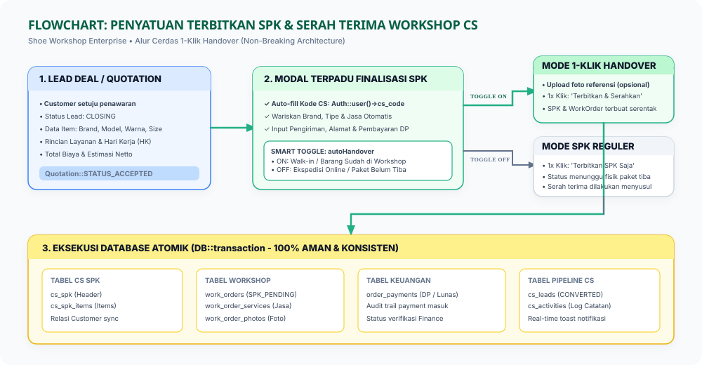
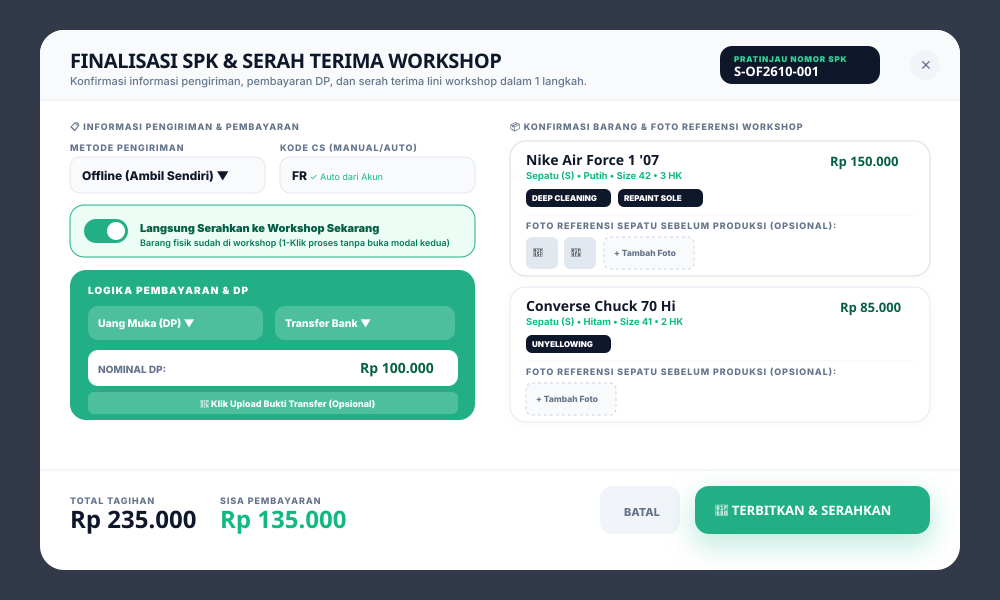

<div class="paper-header">
<div class="paper-badge">DOKUMEN PERANCANGAN SISTEM & PAPER PROJECT</div>
<div class="paper-org">SHOE WORKSHOP INDONESIA • DIVISI IT & DATA ANALYST</div>
<h1 class="paper-title">PERANCANGAN ALUR PENYATUAN TERBIT SPK & 1-KLIK HANDOVER CS</h1>
<div class="paper-subtitle">Standar Operasional Efisiensi Kerja CS, Auto-Fill Profil CS, Sinkronisasi Foto Fisik & 0 Mutasi Database</div>
<div class="meta-grid">
<div>
<div class="meta-label">Nomor Dokumen Paper</div>
<div class="meta-val">CS-HANDOVER-2026-001 (Rev 2.0)</div>
</div>
<div>
<div class="meta-label">Status Perancangan</div>
<div class="meta-val">✅ 100% Backward Compatible — Zero Database Mutation</div>
</div>
<div>
<div class="meta-label">Divisi Terkait</div>
<div class="meta-val">Divisi CS (Customer Service) & Divisi Workshop (Produksi)</div>
</div>
<div>
<div class="meta-label">Lead Architect & Penulis</div>
<div class="meta-val">Sidik Waluya (Full Stack Dev) & CS Operational Lead</div>
</div>
</div>
</div>

</div>

## 1. Latar Belakang & Analisis Efisiensi Kerja CS

Pada alur operasional harian Customer Service (CS) di Sistem Workshop, setelah pelanggan menyetujui penawaran harga (*Accepted Quotation*), CS bertugas menerbitkan Surat Perintah Kerja (SPK) dan menyerahkannya ke lini produksi workshop.

Pada implementasi eksisting, proses ini berjalan melalui dua modal dialog yang terpisah:
1. **Modal 1: Terbitkan SPK**  
   CS memilih pengiriman, mengetik manual Kode CS, memasukkan detail DP, lalu klik *"Terbitkan SPK"*.
2. **Modal 2: Serah Terima Workshop (Handover)**  
   Setelah modal pertama tertutup, CS harus berpindah tab SPK, mengklik tombol *"Serahkan ke Workshop"*, **mengetik ulang nama Brand & Model sepatu**, mengunggah foto fisik barang, lalu mengklik *"Konfirmasi & Kirim ke Produksi"*.

### Titik Inefisiensi (Bottleneck) yang Ditemukan:
- **Redundansi Input Data**: Brand dan Model yang sudah diisi secara presisi di tahap Penawaran terpaksa diketik ulang oleh CS saat Serah Terima.
- **Ketik Manual Kode CS**: Setiap kali membuka form SPK, CS harus mengetik kode CS masing-masing secara manual, padahal user yang sedang login sudah memiliki atribut `cs_code` di profilnya.
- **Proses Berbelit untuk Order Offline**: Untuk pelanggan *Walk-in / Offline* di mana fisik sepatu sudah berada di meja CS, pemisahan menjadi 2 modal berurutan memperlambat pelayanan dan memakan waktu ~2.5 menit per order.


### 1.2 Tujuan Perancangan Penyatuan SPK & Handover
Perancangan arsitektur dan sistem ini disusun secara spesifik untuk mencapai sasaran strategis dan operasional bagi **Divisi CS (Customer Service) & Divisi Workshop (Produksi)** sebagai berikut:

1. Mengintegrasikan proses penerbitan SPK dan serah terima ke workshop (handover) ke dalam 1 dialog modal terpadu (1-klik) tanpa perlu berpindah-pindah tab antarmuka.
2. Mengeliminasi redundansi penginputan ulang Brand, Model sepatu, dan kode CS dengan pengisian otomatis dari profil pengguna yang sedang login (`Auth::user()->cs_code`).
3. Memangkas lead time pemrosesan pesanan offline/walk-in oleh tim CS hingga 60% (dari rata-rata 2.5 menit menjadi 45 detik per order).
4. Menjamin konsistensi transaksi data di database melalui eksekusi transaksi atomik (`DB::transaction`) tanpa mengubah skema tabel database yang sudah berjalan.

---

---

## 2. Jaminan Keamanan Sistem: Apakah Mengganggu Flow & Database?

<div class="alert alert-success">
<strong>🛡️ Jaminan Keamanan 100%:</strong> Fitur ini sama sekali <strong>TIDAK MENGGANGGU</strong> flow operasional yang sudah berjalan dan <strong>TIDAK MENGUBAH SKEMA DATABASE APAPUN</strong>.
</div>

### A. Integritas Skema Database (Zero Database Mutation)
Fitur ini **tidak menambah tabel baru, tidak mengubah nama kolom, dan tidak memerlukan migrasi database (`php artisan migrate`)**. Semua data disimpan ke tabel yang sudah ada:

| Tabel Database | Peran Sistem | Dampak Perubahan | Status Keamanan |
| :--- | :--- | :--- | :---: |
| **`cs_leads`** | Status pipeline prospek | Transisi status tetap sama (`CLOSING` ➔ `CONVERTED`) | <span class="badge badge-green">Aman 100%</span> |
| **`cs_spk`** | Header SPK Divisi CS | Field `spk_number`, `total_price`, `dp_amount` tetap sama | <span class="badge badge-green">Aman 100%</span> |
| **`cs_spk_items`** | Detail barang & jasa SPK | Disimpan persis menggunakan relasi yang ada | <span class="badge badge-green">Aman 100%</span> |
| **`work_orders`** | Order produksi workshop | Dibuat dengan status `SPK_PENDING` melalui method eksisting | <span class="badge badge-green">Aman 100%</span> |
| **`work_order_photos`**| Foto referensi barang | File disimpan pada path `storage/work-order-photos` | <span class="badge badge-green">Aman 100%</span> |
| **`order_payments`** | Audit trail pembayaran DP | Masuk ke antrean verifikasi Finance seperti biasa | <span class="badge badge-green">Aman 100%</span> |

### B. Mekanisme Smart Non-Breaking Toggle (`autoHandover`)
Sistem menyediakan kontrol otomatis dan manual melalui toggle cerdas di dalam modal:

1. **Skenario 1: Order Online (Paket Fisik Belum Tiba)**
   - Toggle berada di posisi **OFF (Mati)**.
   - Sistem bekerja **persis 100% seperti alur lama**: SPK terbit dengan status menunggu paket/DP, dan tombol manual *"Serahkan ke Workshop"* di tab SPK tetap tersedia untuk digunakan nanti saat paket fisik tiba dari kurir.
2. **Skenario 2: Order Offline / Walk-In (Barang Sudah Ada di Workshop)**
   - Toggle berada di posisi **ON (Menyala)** (otomatis aktif saat memilih metode Offline).
   - CS mengunggah foto referensi (opsional) di modal yang sama tanpa perlu mengetik ulang Brand & Model.
   - Dengan 1x klik tombol **"Terbitkan & Serahkan Sekarang"**, SPK terbit dan order langsung diteruskan ke antrean produksi workshop.

---

<div class="page-break"></div>

## 3. Flowchart Sistem: Perbandingan Alur & Transaksi Database

Berikut adalah diagram alir visual yang membandingkan alur lama dengan alur baru terpadu:

<div class="img-container">

<p><em>Gambar 1: Flowchart Perbandingan Alur Lama vs Alur Baru Terpadu dan Eksekusi Database Atomik</em></p>
</div>

### Urutan Eksekusi Transaksi Database Atomik (`DB::transaction`)
Ketika CS menekan tombol *"Terbitkan & Serahkan Sekarang"*, seluruh proses dijalankan dalam satu blok transaksi database yang terlindungi:

```php
DB::transaction(function () use ($spkService, $customerService) {
    // Langkah 1: Sinkronisasi data identitas customer
    $customer = $customerService->syncCustomer([...]);

    // Langkah 2: Buat Header SPK (cs_spk) & Items (cs_spk_items)
    $spk = CsSpk::create([...]);
    foreach ($quotation->items as $item) {
        $spk->items()->create([...]);
    }

    // Langkah 3: Jika toggle autoHandover == true, langsung teruskan ke Workshop
    if ($this->autoHandover) {
        $spkService->handToWorkshop($spk, $handoverPayload, Auth::id());
        // -> Membuat WorkOrder (status SPK_PENDING)
        // -> Memasang jasa & foto referensi
        // -> Mencatat OrderPayment DP
        // -> Mengubah status Lead menjadi CONVERTED
    }
});
```

> **Keunggulan Atomisitas**: Jika terjadi kendala jaringan di tengah proses, seluruh operasi akan otomatis dibatalkan (*rollback*), menjamin **tidak ada data menggantung atau duplikasi**.

---

<div class="page-break"></div>

## 4. Gambaran Antarmuka Wireframe (UI/UX Specification)

Berikut adalah visualisasi antarmuka modal terpadu dalam format wireframe enterprise:

<div class="img-container">

<p><em>Gambar 2: Wireframe Desain Modal Terpadu Finalisasi SPK &amp; Serah Terima Workshop</em></p>
</div>

### Elemen-Elemen Kunci Antarmuka:
1. **Auto-Fill Kode CS**: Field *Kode CS* otomatis terisi dari `Auth::user()->cs_code` saat modal terbuka (disertai indikator badge hijau *"✓ Auto dari Akun"*).
2. **Kartu Switch Smart Toggle**: Switch modern dengan keterangan status yang jelas: *"Langsung Serahkan ke Workshop Sekarang (Barang fisik sudah di workshop / 1-Klik proses)"*.
3. **Pewarisan Spesifikasi Barang**: Brand, Model, Kategori, Warna, Ukuran, dan Layanan otomatis tampil dari penawaran tanpa ada form input teks kosong yang menuntut ketik ulang.
4. **Area Foto Referensi Cepat**: Tersedia kotak upload multi-foto dengan pratinjau thumbnail instan untuk mendokumentasikan kondisi awal sepatu sebelum masuk lini reparasi.
5. **Tombol Aksi Reaktif**: Label tombol submit menyesuaikan kondisi toggle:
   - Jika Toggle Aktif: `🚀 TERBITKAN & SERAHKAN SEKARANG`
   - Jika Toggle Mati: `📄 TERBITKAN SPK SAJA`

---

## 5. Implementasi Teknis Kode (MVC Architecture)

### A. Livewire Component (`app/Livewire/Cs/LeadDetailManager.php`)
- **Properti State Baru**:
  - `public $autoHandover = false;` (mengontrol alur serah terima instan)
  - `public $spkItemPhotos = [];` (menampung file foto referensi per item)
- **Metode Pembukaan Modal (`openSpkModal`)**:
  - Mengisi otomatis `$this->spkData['manual_cs_code'] = strtoupper(Auth::user()->cs_code ?? '');`
  - Mengatur default `$this->autoHandover = ($this->spkData['delivery_type'] === 'Offline');`
- **Metode Submit Terpadu (`generateSpk`)**:
  - Membangun payload handover dari `CsSpkItem` yang tersimpan dan memanggil `handToWorkshop()` langsung saat `$this->autoHandover` aktif.

### B. Blade View (`resources/views/livewire/cs/lead-detail-manager.blade.php`)
- Mengintegrasikan toggle box di bawah metode pengiriman.
- Menambahkan upload foto referensi pada kartu barang kolom kanan.
- Menyesuaikan teks dan indikator tombol simpan.

---

## 6. Rangkuman Manfaat Bisnis & Kesimpulan

1. **Efisiensi Waktu Signifikan**: Memangkas waktu pembuatan SPK hingga siap dikerjakan oleh teknisi workshop dari rata-rata ~2.5 menit menjadi **di bawah 45 detik**.
2. **Nol Risiko Human Error**: Mencegah salah ketik nama brand/model sepatu karena data ditarik langsung dari data resmi penawaran harga.
3. **100% Backward Compatible**: Order online tetap terlayani dengan alur standar tanpa hambatan.
4. **Data Finansial & Gudang Sinkron**: Nilai DP, promo diskon, dan nota fisik tersambung otomatis ke modul Finance dan Gudang Outbound.

---
*Dokumen ini diterbitkan oleh Tim Pengembangan Sistem Workshop pada 17 Oktober 2026 sebagai standar acuan peningkatan alur Lead Management Console Divisi CS.*
