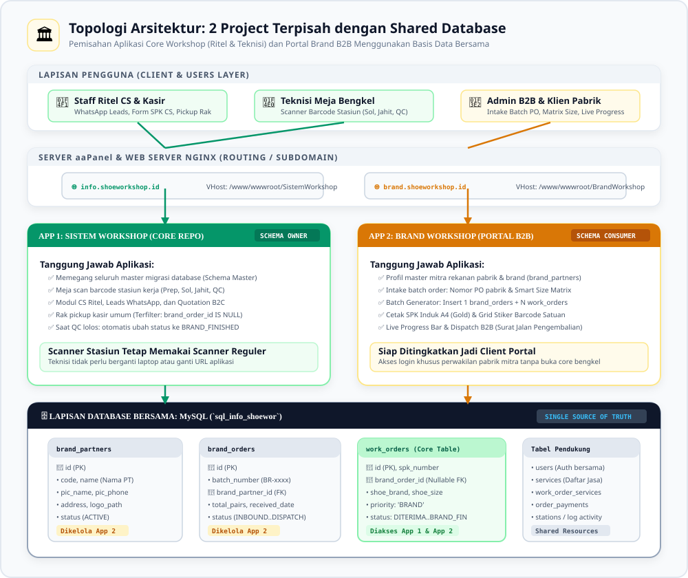
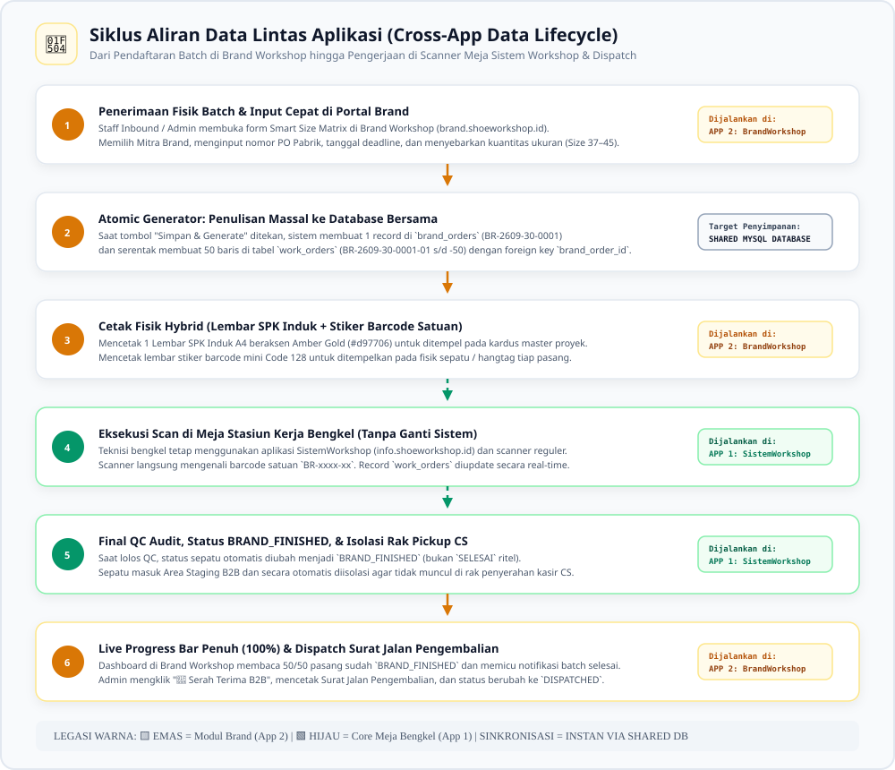
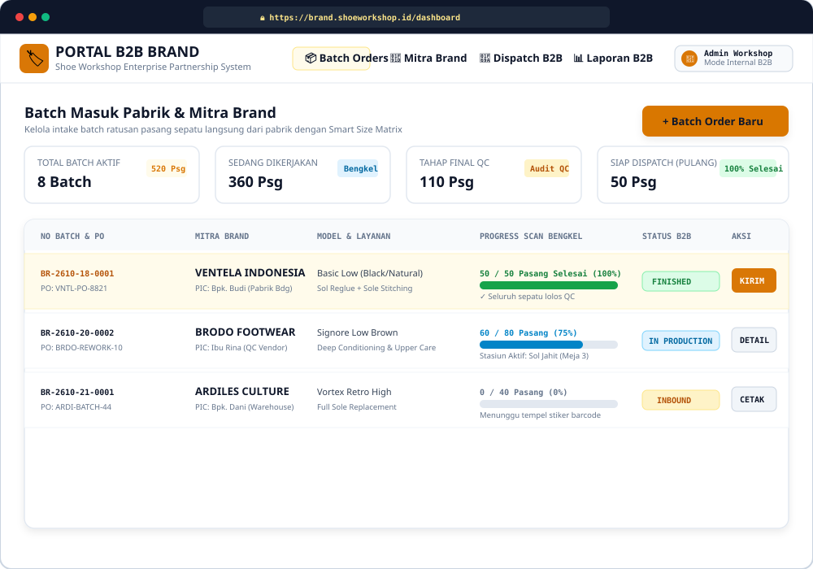

<div class="paper-header">
<div class="paper-badge">DOKUMEN PERANCANGAN SISTEM & PAPER PROJECT</div>
<div class="paper-org">SHOE WORKSHOP INDONESIA • DIVISI IT & DATA ANALYST</div>
<h1 class="paper-title">ANALISIS ARSITEKTUR PEMISAHAN APLIKASI MANAJEMEN BRAND BERBASIS SHARED DATABASE</h1>
<div class="paper-subtitle">Kajian Kelayakan Rekayasa Sistem Decoupled Multi-App, Tata Kelola Master Schema Migrations, Zero-Downtime Deployment, & Integrasi Portal Mandiri Mitra Pabrik</div>
<div class="meta-grid">
<div>
<div class="meta-label">Nomor Dokumen Paper</div>
<div class="meta-val">ARCH-DECOUPLED-2026-001 (Rev 2.0)</div>
</div>
<div>
<div class="meta-label">Status Perancangan</div>
<div class="meta-val">✅ Architectural Blueprint Approved (Zero Blast Radius)</div>
</div>
<div>
<div class="meta-label">Divisi Terkait</div>
<div class="meta-val">Divisi Workshop (Produksi), Divisi Finance, & Divisi IT</div>
</div>
<div>
<div class="meta-label">Lead Architect & Penulis</div>
<div class="meta-val">Sidik Waluya (Full Stack Dev) & AI Enterprise Architect</div>
</div>
</div>
</div>

## Bab 1: Eksekutif Ringkasan & Latar Belakang Masalah

### 1.1 Konteks Arsitektur
Dalam arsitektur perangkat lunak skala enterprise, terdapat pertanyaan fundamental saat menambahkan modul bisnis baru yang memiliki karakteristik operasional berbeda:
> *"Apakah modul baru ini sebaiknya digabungkan ke dalam proyek monolit yang sudah ada, atau dipisahkan ke dalam repository/aplikasi mandiri namun tetap berbagi basis data yang sama (Shared Database Pattern)?"*

### 1.2 Tujuan Perancangan & Analisis Arsitektur
Perancangan arsitektur dan sistem ini disusun secara spesifik untuk mencapai sasaran strategis dan operasional bagi **Divisi Workshop (Produksi), Divisi Finance, & Divisi IT** sebagai berikut:

1. Menganalisis dan merumuskan kelayakan arsitektur pemisahan modul B2B Brand (`brand.shoeworkshop.id`) dari repositori sistem workshop utama (`info.shoeworkshop.id`).
2. Mengeliminasi risiko gangguan sistem (*zero blast radius*) agar rilis fitur kemitraan pabrik tidak mengganggu operasional kasir, CS, atau scanner meja teknisi bengkel.
3. Menetapkan tata kelola kepemilikan migrasi database (*Master Schema Owner*) pada repositori utama demi menjaga integritas basis data bersama tanpa konflik skema.
4. Merancang transisi bertahap menuju portal mandiri (*Self-Service Client Portal*) bagi perwakilan pabrik mitra untuk memantau status pesanan dan tagihan secara independen.

---

Pada kasus **Shoe Workshop**, sistem utama (`SistemWorkshop`) saat ini menangani transaksi ritel pelanggan B2C yang sangat dinamis, alur penawaran Customer Service (CS WhatsApp), antrean kasir, serta meja pemindai barcode teknisi di lantai bengkel.

Sementara itu, **Modul Manajemen Brand (B2B)** memiliki karakteristik bisnis yang sangat berbeda:
1. **Model Transaksi Massal (Batch Inbound)**: Sekali masuk memuat 50 hingga 200 pasang sepatu langsung dari pabrik (contoh: Ventela, Brodo, Aerostreet) tanpa melalui chat CS.
2. **Kebutuhan Subdomain Khusus**: Diperlukan domain profesional seperti `brand.shoeworkshop.id` untuk membedakan citra korporat B2B dari sistem bengkel internal.
3. **Kesiapan Menuju Portal Klien (*Self-Service Client Portal*)**: Di masa mendatang, pihak perwakilan pabrik dapat diberikan akses login khusus untuk memantau progres pengerjaan sepatu mereka secara transparan tanpa melihat dapur rahasia data pelanggan ritel workshop.

### 1.2 Kesimpulan Kajian Awal
Memisahkan Modul Brand ke dalam **Proyek Laravel Baru (`BrandWorkshop`)** yang berbagi basis data MySQL (`sql_info_shoewor`) yang sama adalah **pilihan arsitektur yang sangat tepat, fleksibel (*future-proof*), dan berisiko rendah**. Pola ini mengisolasi risiko kode tanpa memerlukan arsitektur microservices API yang rumit.

---

<div class="page-break"></div>

## Bab 2: Diagram Topologi Arsitektur Sistem Terpisah (Shared Database)

Berikut adalah visualisasi topologi arsitektur yang memisahkan lapisan pengguna, lapisan routing Nginx di aaPanel, dua aplikasi Laravel independen, serta lapisan basis data bersama:

<div align="center" style="margin: 18pt 0;">

</div>

### Penjelasan Komponen Topologi:
1. **Lapisan Akses Klien (Clients Layer)**:
   * **Staff CS & Kasir Ritel**: Mengakses `info.shoeworkshop.id` untuk mengelola lead, quotation, dan rak pickup ritel.
   * **Teknisi Meja Bengkel**: Mengakses `info.shoeworkshop.id` pada monitor stasiun kerja menggunakan scanner barcode USB/Bluetooth reguler.
   * **Admin B2B & Klien Mitra Pabrik**: Mengakses `brand.shoeworkshop.id` untuk intake batch PO pabrik, smart size matrix, dan pemantauan progress bar.
2. **Lapisan Server aaPanel & Nginx Routing**:
   * Nginx membagi trafik berdasarkan server name (Virtual Host):
     * `info.shoeworkshop.id` diarahkan ke direktori `/www/wwwroot/info.shoeworkshop.id/DivisiWorkshop/public`.
     * `brand.shoeworkshop.id` diarahkan ke direktori `/www/wwwroot/brand.shoeworkshop.id/public`.
3. **Lapisan Aplikasi (Two Decoupled Laravel Instances)**:
   * **App 1 (`SistemWorkshop`)**: Bertindak sebagai *Master Schema Owner*. Memegang kontrol atas migrasi database, scanner meja bengkel, dan isolasi rak pickup.
   * **App 2 (`BrandWorkshop`)**: Bertindak sebagai *Schema Consumer*. Memegang antarmuka B2B, smart matrix generator, dan modul serah terima dispatch pengembalian.
4. **Lapisan Basis Data Bersama (Single Source of Truth)**:
   * Kedua aplikasi terkoneksi ke MySQL database yang sama: `sql_info_shoewor`.
   * Tabel bersama: `work_orders`, `brand_orders`, `brand_partners`, `work_order_services`, dan `users`.

---

<div class="page-break"></div>

## Bab 3: Analisis Komparasi Mendalam: Monolit vs Shared Database Terpisah

Berikut adalah evaluasi teknis multi-dimensi antara mempertahankan satu proyek monolit vs memisahkannya menjadi proyek tersendiri berbasis shared database:

| Dimensi Penilaian | Opsi 1: Tetap 1 Project Monolit (`SistemWorkshop`) | Opsi 2: Pisah Project Laravel Baru (`BrandWorkshop` + Shared DB) |
| :--- | :--- | :--- |
| **Isolasi Risiko Kode (*Blast Radius*)** | ⚠️ **Cukup Rentan**: Modifikasi besar pada modul Brand berpotensi memicu regresi bug atau downtime pada alur CS dan kasir ritel. | 🟢 **Aman Sempurna (Zero Blast Radius)**: Kerusakan atau error fatal pada Portal Brand mustahil menghentikan operasional bengkel utama. |
| **Kesiapan Portal Eksternal Brand** | ❌ **Sulit**: Memberikan akses login pihak luar ke dalam aplikasi internal workshop rawan kebocoran data (*data leakage*) pelanggan ritel. | 🟢 **Sangat Siap (*Future-Proof*)**: Aplikasi terisolasi secara fisik sehingga aman diberikan akses login mandiri bagi PIC pabrik mitra. |
| **Kerapian Codebase** | ⚠️ **Bloated**: Lebih dari 11.000 komponen bertumpuk dalam satu repository yang membuat waktu build dan navigasi kode semakin berat. | 🟢 **Sangat Bersih & Ringan**: Repository Brand hanya memuat controller, view, dan service yang murni relevan untuk B2B. |
| **Independensi Deployment** | ⚠️ **Tergantung**: Deploy fitur B2B memerlukan `optimize:clear` yang sesaat dapat mereset cache sesi teknisi di jam kerja sibuk. | 🟢 **Bebas Kapan Saja**: Tim pengembang dapat melakukan rilis fitur B2B sewaktu-waktu tanpa mengganggu staf meja bengkel. |
| **Kebutuhan Sinkronisasi Data** | 🟢 **Alami**: Karena satu memori aplikasi. | 🟢 **Instan**: Karena mengakses tabel MySQL yang sama secara langsung, **tanpa latensi network API**. |
| **Kompleksitas Perawatan (*Maintenance*)**| 🟢 **1 Repo**: Hanya perlu merawat 1 konfigurasi `.env` dan 1 pipeline git. | ⚠️ **2 Repo**: Perlu memastikan skema tabel database dikelola secara disiplin melalui satu pintu master migrasi. |

---

<div class="page-break"></div>

## Bab 4: Protokol Kepemilikan Migrasi Database (Master Schema Owner Protocol)

Tantangan teknis terbesar dari pola *Shared Database* pada ekosistem Laravel adalah **konflik tabel `migrations`**. Jika kedua proyek menjalankan perintah `php artisan migrate`, nomor batch dan pencatatan riwayat migrasi di database akan saling menimpa (*migration collision*).

Untuk mencegah hal tersebut, sistem mengadopsi standar tata kelola database enterprise:

```
[ SistemWorkshop (Core Repo) ]  ======>  [ MASTER SCHEMA OWNER ]
       (Memegang file migrasi)                 |
                                               | Menjalankan `php artisan migrate`
                                               v
                                  [ MySQL: sql_info_shoewor ]
                                  - brand_partners
                                  - brand_orders
                                  - work_orders (brand_order_id)
                                               ^
                                               | Hanya membaca & menulis data
                                               | (Tanpa file migrasi lokal)
[ BrandWorkshop (B2B Repo) ]    ======>  [ SCHEMA CONSUMER ]
```

### Aturan Baku Protokol:
1. **Hak Cipta Migrasi Eksklusif**: Seluruh berkas migrasi tabel:
   * `create_brand_partners_table.php`
   * `create_brand_orders_table.php`
   * `add_brand_order_id_to_work_orders_table.php`
   **Hanya dibuat dan dieksekusi di dalam repository `SistemWorkshop`**.
2. **Larangan Eksekusi Migrasi di Project Brand**: Pada repository `BrandWorkshop`, direktori `database/migrations` dikosongkan dari tabel bersama atau dinonaktifkan, sehingga perintah deployment di server `BrandWorkshop` tidak pernah mengeksekusi migrasi yang merusak skema core.
3. **Model Eloquent Berbagi Skema**: Model di `BrandWorkshop` (`App\Models\WorkOrder`, `App\Models\BrandOrder`, `App\Models\BrandPartner`) langsung membaca tabel-tabel tersebut dengan mendefinisikan properti `$table` dan `$fillable` yang selaras.

---

<div class="page-break"></div>

## Bab 5: Siklus Aliran Data Lintas Aplikasi (Cross-App Data Lifecycle)

Berikut adalah diagram alir yang memetakan perjalanan satu batch pesanan brand dari saat diterima, diproses di scanner meja bengkel, hingga dikembalikan ke pabrik mitra:

<div align="center" style="margin: 18pt 0;">

</div>

### Tahapan Operasional Berjenjang:
* **Langkah 1 (Brand Workshop)**: Admin menginput batch baru via form Smart Size Matrix di `brand.shoeworkshop.id`.
* **Langkah 2 (Shared DB)**: Eksekusi atomik menulis 1 record `brand_orders` dan $N$ record `work_orders` dengan penomoran urut (`BR-2610-21-0001-01` s/d `-50`).
* **Langkah 3 (Brand Workshop)**: Mencetak 1 Lembar SPK Induk A4 (warna Amber Gold `#d97706`) dan stiker barcode satuan Code 128.
* **Langkah 4 (Sistem Workshop)**: Teknisi di lantai bengkel tetap berada di `info.shoeworkshop.id`. Saat memindai barcode stiker satuan, sistem core langsung menemukan id sepatu tersebut di tabel `work_orders` dan mencatat stasiun pengerjaan (Sol, Jahit, Repaint).
* **Langkah 5 (Sistem Workshop)**: Saat lolos QC akhir, sistem core mendeteksi adanya `brand_order_id` dan secara otomatis menandai status sepatu menjadi **`BRAND_FINISHED`** (bukan `SELESAI` ritel), sehingga **sepatu terisolasi 100% dari rak penyerahan kasir CS**.
* **Langkah 6 (Brand Workshop)**: Progress bar pada dashboard B2B otomatis menunjukkan `50/50 Selesai (100%)`. Admin mencetak Surat Jalan Pengembalian (*Delivery Note B2B*) dan mengalihkan status akhir menjadi **`DISPATCHED`**.

---

<div class="page-break"></div>

## Bab 6: Spesifikasi Antarmuka Portal B2B Brand (Hybrid Client & Admin Portal)

Antarmuka `BrandWorkshop` dirancang khusus dengan tema korporat B2B (**Amber Gold / Slate Navy**) yang intuitif dan profesional:

<div align="center" style="margin: 18pt 0;">

</div>

### Fitur Kunci Desain Antarmuka:
1. **Header Eksklusif Subdomain**: Menampilkan branding `brand.shoeworkshop.id` yang independen dari tampilan operasional bengkel umum.
2. **KPI Tracker Khusus B2B**: Menampilkan kuantitas pasang aktif dalam batch, total sepatu yang sedang di meja bengkel, sepatu yang sedang di audit QC, dan batch yang siap kirim pulang (*dispatched*).
3. **Progress Bar Real-Time**: Tim B2B dapat melihat pergerakan sepatu di bengkel secara transparan tanpa perlu menelepon atau bertanya langsung ke kepala produksi.
4. **Tombol Cepat Cetak & Dispatch**: Aksi satu kali klik untuk mencetak lembar SPK Induk kardus dan menerbitkan Surat Jalan resmi.

---

<div class="page-break"></div>

## Bab 7: Tata Kelola Autentikasi, Keamanan, & Single Sign-On (SSO)

Untuk menjamin keamanan dan kenyamanan penggunaan oleh staf, sistem menerapkan tata kelola otentikasi bertahap:

### 7.1 Autentikasi Staf Internal (Fase Awal)
* **Tabel Pengguna Bersama (`users`)**: Staf Admin Workshop dan Kepala Produksi menggunakan akun kredensial (email & password terenkripsi) yang sama dengan sistem workshop core.
* **Domain Session Sharing (Opsional)**: Dengan mengatur variabel konfigurasi sesi pada `.env` kedua aplikasi:
  ```env
  SESSION_DRIVER=cookie
  SESSION_DOMAIN=.shoeworkshop.id
  ```
  Staf yang telah login di `info.shoeworkshop.id` dapat langsung membuka `brand.shoeworkshop.id` tanpa harus memasukkan ulang password (*Seamless Single Sign-On*).

### 7.2 Persiapan Portal Klien Eksternal Mitra Brand (Fase Lanjutan)
Saat Shoe Workshop memutuskan membuka portal mandiri bagi PIC pabrik mitra:
* Diterapkan sistem **Multi-Auth Guard** di `BrandWorkshop`:
  * Guard `web`: Untuk staf internal workshop (Role: Admin, Kepala Produksi).
  * Guard `brand_client`: Menggunakan kredensial dari tabel `brand_partners` (username/email PIC pabrik).
* Klien pabrik yang login hanya dapat melihat data pesanan yang memiliki `brand_partner_id` sesuai dengan ID perusahaan mereka (*Strict Tenant Scoping*).

---

<div class="page-break"></div>

## Bab 8: Panduan Konfigurasi Server aaPanel & Web Server Nginx

Berikut adalah panduan standar deployment dua proyek di server aaPanel (Ubuntu 22.04 LTS):

### 8.1 Struktur Direktori di Server aaPanel
```text
/www/wwwroot/
├── info.shoeworkshop.id/
│   └── DivisiWorkshop/            <-- App 1: Sistem Workshop (Core)
│       ├── .env                   <-- DB: sql_info_shoewor
│       ├── public/
│       └── database/migrations/   <-- Master Schema Owner
│
└── brand.shoeworkshop.id/         <-- App 2: Brand Workshop (Portal B2B)
    ├── .env                       <-- DB: sql_info_shoewor (Sama)
    ├── public/
    └── app/                       <-- B2B Intake & Generator Logic
```

### 8.2 Konfigurasi Virtual Host Nginx (`brand.shoeworkshop.id.conf`)
```nginx
server {
    listen 80;
    listen 443 ssl http2;
    server_name brand.shoeworkshop.id;
    index index.php index.html;
    root /www/wwwroot/brand.shoeworkshop.id/public;

    # SSL Configuration (Let's Encrypt via aaPanel)
    ssl_certificate /www/server/panel/vhost/cert/brand.shoeworkshop.id/fullchain.pem;
    ssl_certificate_key /www/server/panel/vhost/cert/brand.shoeworkshop.id/privkey.pem;

    location / {
        try_files $uri $uri/ /index.php?$query_string;
    }

    # Eksekusi PHP 8.2 aaPanel
    location ~ \.php$ {
        fastcgi_pass unix:/tmp/php-cgi-82.sock;
        fastcgi_index index.php;
        include fastcgi.conf;
        fastcgi_param SCRIPT_FILENAME $document_root$fastcgi_script_name;
    }

    location ~ /\.ht {
        deny all;
    }
}
```

---

<div class="page-break"></div>

## Bab 9: Roadmap Eksekusi & Kesimpulan Rekomendasi

### 9.1 Tahapan Roadmap Pelaksanaan

| Tahap | Tindakan Teknis | Lokasi Pengerjaan | Waktu Estimasi |
| :---: | :--- | :--- | :---: |
| **Fase 1** | Pembuatan berkas migrasi `brand_partners`, `brand_orders`, dan relasi `work_orders.brand_order_id`. Eksekusi migrasi di database core. | `SistemWorkshop` | 1 Hari |
| **Fase 2** | Penambahan status proteksi `BRAND_FINISHED` dan isolasi rak pickup kasir CS. | `SistemWorkshop` | 1 Hari |
| **Fase 3** | Inisialisasi proyek baru `BrandWorkshop`, konfigurasi koneksi shared DB, dan pembuatan model Eloquent B2B. | `BrandWorkshop` | 1 Hari |
| **Fase 4** | Pembangunan CRUD Mitra Brand, Form Smart Size Matrix, dan Atomic Batch Generator. | `BrandWorkshop` | 2 Hari |
| **Fase 5** | Pembuatan template cetak SPK Induk Amber A4 dan Grid Stiker Barcode Satuan. | `BrandWorkshop` | 1 Hari |
| **Fase 6** | Pengujian integrasi lintas aplikasi di lingkungan lokal Laragon (Simulasi scan barcode satuan di meja bengkel). | Lintas Proyek | 1 Hari |
| **Fase 7** | Deployment ke server produksi aaPanel (`brand.shoeworkshop.id`) & aktivasi SSL. | Server aaPanel | 1 Hari |

---

### 9.2 Kesimpulan Final

Keputusan untuk **memisahkan Modul Brand ke dalam Proyek Laravel Mandiri berbasis Basis Data Bersama (*Shared Database Pattern*)** adalah langkah arsitektural yang **sangat direkomendasikan**:
1. Menjaga stabilitas aplikasi bengkel utama tetap 100% aman tanpa risiko bentrok kode ritel.
2. Memberikan kebebasan mendesain portal B2B profesional yang siap dinaikkan kelasnya menjadi *Client Portal* bagi pabrik mitra di masa depan.
3. Tetap mempertahankan efisiensi meja bengkel di mana seluruh teknisi tidak perlu berganti laptop atau scanner baru untuk mengerjakan sepatu batch brand.

---

<div class="cover-footer" style="margin-top: 50px;">
<span>Dokumen Kajian Arsitektur Resmi Sistem Workshop • Shoe Workshop Indonesia</span>
<span>Selesai — Halaman Terakhir</span>
</div>
