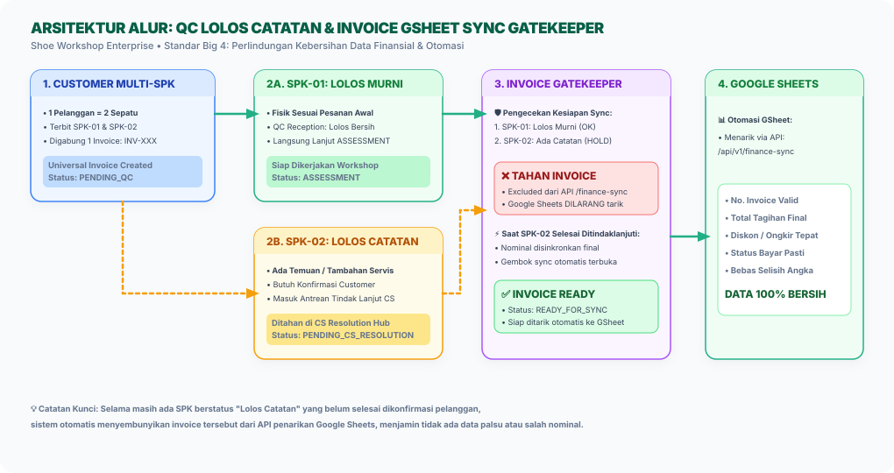
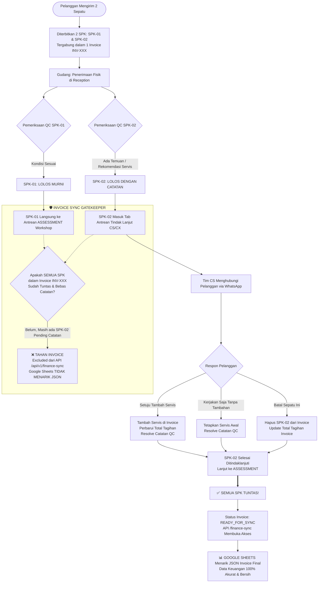

<div class="paper-header">
<div class="paper-badge">DOKUMEN PERANCANGAN SISTEM & PAPER PROJECT</div>
<div class="paper-org">SHOE WORKSHOP INDONESIA • DIVISI IT & DATA ANALYST</div>
<h1 class="paper-title">PERANCANGAN ALUR QC LOLOS CATATAN & INVOICE SYNC GATEKEEPER</h1>
<div class="paper-subtitle">Pemisahan Alur QC (Lolos Murni vs Lolos dengan Catatan) & Otomasi Gembok Sinkronisasi Google Sheets untuk Menjamin Keakuratan Data Keuangan 100%</div>
<div class="meta-grid">
<div>
<div class="meta-label">Nomor Dokumen Paper</div>
<div class="meta-val">ARCH-2026-QC-INV-001 (Rev 2.0)</div>
</div>
<div>
<div class="meta-label">Status Perancangan</div>
<div class="meta-val">✅ Final Approved — Siap Eksekusi (Zero Defect)</div>
</div>
<div>
<div class="meta-label">Divisi Terkait</div>
<div class="meta-val">Divisi Gudang (Reception/Shipping), Divisi CC / CX, & Divisi Finance</div>
</div>
<div>
<div class="meta-label">Lead Architect & Penulis</div>
<div class="meta-val">Sidik Waluya (Full Stack Dev) & AI Architecture Lead</div>
</div>
</div>
</div>

</div>

## 📌 1. Ringkasan Eksekutif & Latar Belakang Masalah

Dalam operasional harian Divisi Penerimaan Barang (*Reception / Warehouse Inbound*), satu pelanggan sering kali mengirimkan **lebih dari satu pasang sepatu sekaligus** dalam satu hari transaksi (contoh: 1 Pelanggan mengirimkan 2 sepatu yang diterbitkan menjadi 2 nomor SPK berbeda).

Secara sistem akuntansi keuangan, kedua SPK tersebut digabungkan ke dalam **1 Invoice Terpadu (*Universal Invoice*)**.

### ⚠️ Masalah Utama yang Terjadi di Lapangan Saat Ini (*Current Problem*):
1. **Pemeriksaan Fisik Sepatu Berbeda Nasib:**
   - Sepatu #1: Kondisi fisik bersih dan sesuai pesanan $\rightarrow$ **Lolos Murni**.
   - Sepatu #2: Ada temuan fisik minor (misal: lem sol mulai getas, ada noda jamur tersembunyi, atau butuh servis *deep clean/unyellowing* tambahan) $\rightarrow$ **Lolos dengan Catatan**.
2. **Sinkronisasi Otomatis ke Google Sheets Terlalu Dini (*Premature Sync*):**
   - API `/api/v1/finance-sync` saat ini langsung menarik seluruh invoice yang berstatus aktif ke Google Sheets.
   - Akibatnya, data Invoice langsung terkirim ke Google Sheets saat Sepatu #1 lolos, **padahal Sepatu #2 masih butuh konfirmasi biaya/layanan tambahan dari pelanggan**.
3. **Dampak Fatal ke Keuangan:**
   - Jika setelah dikonfirmasi pelanggan menyetujui servis tambahan $\rightarrow$ Nilai tagihan berubah, tetapi Google Sheets sudah terlanjur mencatat nominal lama.
   - Jika pelanggan menolak dan membatalkan sepatu #2 $\rightarrow$ Invoice di Google Sheets menjadi selisih (*dirty data*) dan membutuhkan revisi manual yang membingungkan tim finance.


### 1.2 Tujuan Perancangan Sistem QC Catatan & Finance Lock
Perancangan arsitektur dan sistem ini disusun secara spesifik untuk mencapai sasaran strategis dan operasional bagi **Divisi Gudang (Reception/Shipping), Divisi CC / CX, & Divisi Finance** sebagai berikut:

1. Mengakomodasi penanganan sepatu yang lolos uji kualitas dengan catatan minor tanpa menahan pengiriman fisik barang di meja Gudang pengiriman.
2. Menyediakan antrean tindak lanjut khusus bagi tim Customer Care (CC/CX) untuk mengonfirmasi catatan pengerjaan dan solusi kompensasi ke pelanggan secara cepat.
3. Menerapkan sistem gembok (*Gatekeeper Lock*) pada otomasi API sinkronisasi invoice ke Google Sheets agar order yang belum disetujui pelanggan tidak masuk ke pembukuan finance.
4. Menjamin keakuratan 100% data keuangan, piutang, dan omzet harian pada Divisi Finance tanpa ada potensi pembatalan transaksi pasca-sinkronisasi.

---

---

## 🎯 2. Tujuan & Sasaran Solusi (*Target Objectives*)

1. **Pemisahan Alur QC yang Tegas:**
   - **Lolos Murni:** Sepatu langsung meluncur ke antrean teknisi (*Assessment / Workshop*) tanpa hambatan.
   - **Lolos dengan Catatan:** Sepatu ditampung di antrean khusus (*Tindak Lanjut Catatan QC / CX Issues*) agar Tim CS/CX mengonfirmasi temuan ke pelanggan.
2. **Penjaga Gerbang Otomasi Invoice (*Invoice Sync Gatekeeper*):**
   - Invoice **DILARANG KERAS** ditarik ke Google Sheets / Webhook jika masih ada SPK di dalam invoice tersebut yang berstatus *Lolos dengan Catatan* dan **belum selesai dikonfirmasi (*Unresolved*)**.
3. **Pelepasan Otomatis (*Auto-Release Sync*):**
   - Begitu SPK yang memiliki catatan diselesaikan oleh Tim CS (baik disetujui ada biaya tambahan, disetujui tanpa biaya, atau dibatalkan), sistem secara otomatis mengunci invoice sebagai **`Ready for Sync`**.
   - Google Sheets baru akan menarik data invoice tersebut pada penarikan berikutnya dalam kondisi data yang **100% final, akurat, dan valid**.

---

## 🔄 3. Diagram Alur Bisnis & Logika Sistem (*Business Process Flow*)

### A. Diagram Arsitektur Visual (Vector Diagram)

<div align="center" style="margin: 20px 0;">

<p style="font-size: 11px; color: #64748b; margin-top: 6px;"><em>Gambar 1: Alur Pemisahan QC Lolos Murni vs Catatan dan Mekanisme Gembok Sinkronisasi Google Sheets.</em></p>
</div>

### B. Diagram Alur Logika Eksekusi Sistem (Mermaid Flowchart)



---

<div class="page-break"></div>

## 🛠️ 4. Rancangan Arsitektur Database & Model

Untuk mendukung alur ini secara elegan tanpa merusak struktur database yang ada, diusulkan penambahan field dan status terpadu:

### A. Perubahan pada Model `WorkOrder` (SPK)
Menambahkan status atau sub-status pada kolom `warehouse_qc_status`:
- `'lolos'` : Lolos Murni (langsung ke Assessment).
- `'lolos_catatan'` : Lolos dengan Catatan (ditahan di antrean CS/CX).
- `'reject'` : Ditolak / Tidak lolos QC.

Kolom pendukung:
- `qc_notes_status` : `ENUM('NONE', 'PENDING_CS', 'RESOLVED')` DEFAULT `'NONE'`.
- `qc_notes_resolved_at` : `DATETIME NULL` (Waktu CS menyelesaikan catatan).
- `qc_notes_resolved_by` : `BIGINT UNSIGNED NULL` (ID CS yang menyelesaikan).

### B. Perubahan pada Model `Invoice`
Menambahkan atribut status sinkronisasi otomasi:
- `sync_status` : `ENUM('PENDING_QC', 'ON_HOLD', 'READY', 'SYNCED')` DEFAULT `'PENDING_QC'`.
  * `PENDING_QC`: Masih ada sepatu yang belum diperiksa fisik di gudang.
  * `ON_HOLD`: Ada minimal 1 sepatu yang *Lolos dengan Catatan* dan belum diselesaikan CS.
  * `READY`: Seluruh sepatu telah selesai diperiksa dan semua catatan tuntas diselesaikan.
  * `SYNCED`: Sudah ditarik oleh sistem otomasi Google Sheets.

### C. Helper Method pada Model `Invoice`:
```php
public function isReadyForSync(): bool
{
    // Cek seluruh SPK yang terhubung ke Invoice ini
    $activeOrders = $this->workOrders()->whereNotIn('status', [
        WorkOrderStatus::BATAL,
        WorkOrderStatus::DONASI
    ])->get();

    // 1. Jika tidak ada order aktif, jangan sync
    if ($activeOrders->isEmpty()) {
        return false;
    }

    // 2. Jika masih ada order yang belum melewati QC Reception
    $hasUncheckedQc = $activeOrders->contains(function ($order) {
        return empty($order->warehouse_qc_status);
    });
    if ($hasUncheckedQc) {
        return false;
    }

    // 3. JIKA ADA ORDER YANG LOLOS DENGAN CATATAN TAPI BELUM RESOLVED
    $hasPendingNotes = $activeOrders->contains(function ($order) {
        return $order->warehouse_qc_status === 'lolos_catatan' 
            && $order->qc_notes_status !== 'RESOLVED';
    });
    if ($hasPendingNotes) {
        return false; // TAHAN SINKRONISASI!
    }

    return true; // SELURUH SEPATU SUDAH AMAN & FINAL
}
```

---

## 📡 5. Rancangan Filter API Sinkronisasi Google Sheets (`sync_finance_v2.php`)

Penarikan data Google Sheets saat ini dijalankan secara langsung oleh berkas mandiri [public/api/sync_finance_v2.php](file:///c:/laragon/www/SistemWorkshop/public/api/sync_finance_v2.php).

### A. Analisis Kueri Saat Ini (Akar Masalah GSheet)
Pada baris 65–94 di `sync_finance_v2.php`:
```sql
SELECT 
    i.invoice_number as nomor_invoice, 
    c.name AS customer_name,
    c.phone AS customer_phone, 
    ...
FROM 
    invoices i
LEFT JOIN 
    customers c ON i.customer_id = c.id
WHERE 
    i.created_at > '2026-02-01 00:00:00'
ORDER BY 
    i.created_at DESC
```
**Mengapa Terjadi Masalah:**
Kueri ini sama sekali tidak memeriksa status pengerjaan maupun status QC masing-masing SPK di tabel `work_orders`. Setiap invoice yang baru dibuat otomatis langsung ditarik oleh Google Sheets pada tarikan berikutnya, meskipun ada sepatu yang masih tertahan di antrean *Lolos dengan Catatan*.

---

### B. Solusi Terpilih: Pendekatan Hybrid / Flag Cepat (`sync_status`)
Untuk menjaga performa penarikan Google Sheets tetap super cepat (di bawah 10 milidetik per request) tanpa melakukan *heavy JOIN* atau subquery yang membebani MySQL, kita menambahkan kolom terindeks `sync_status` pada tabel `invoices`:

```sql
ALTER TABLE invoices ADD COLUMN sync_status VARCHAR(20) DEFAULT 'PENDING_QC' AFTER status;
ALTER TABLE invoices ADD INDEX idx_sync_status (sync_status);
```

#### Modifikasi Kueri di `public/api/sync_finance_v2.php`:
```sql
SELECT 
    i.invoice_number as nomor_invoice, 
    c.name AS customer_name,
    c.phone AS customer_phone, 
    c.email AS customer_email,
    i.status AS status_pembayaran_gabungan,
    i.paid_amount AS amount_paid,
    i.total_amount AS total_bill,
    i.shipping_cost,
    (i.total_amount + COALESCE(i.shipping_cost, 0) - i.paid_amount - i.discount) AS remaining_balance,
    i.discount,
    i.invoice_dp_url,
    i.invoice_final_url,
    i.invoice_full_url,
    i.dp_unique_code,
    i.final_unique_code,
    i.total_dp_with_code as total_dp,
    i.total_pelunasan_with_code as total_pelunasan,
    i.spk_status,
    i.estimasi_selesai,
    i.created_at,
    i.updated_at
FROM 
    invoices i
LEFT JOIN 
    customers c ON i.customer_id = c.id
WHERE 
    i.created_at > '2026-02-01 00:00:00'
    AND (i.sync_status = 'READY' OR i.sync_status IS NULL)
ORDER BY 
    i.created_at DESC
```

### C. Keunggulan & Kompatibilitas Data Lama (*Backward Compatibility*)
1. **Performa Instan:** Menggunakan indeks `idx_sync_status`, MySQL langsung mengabaikan baris invoice yang berstatus `'ON_HOLD'` atau `'PENDING_QC'` dengan biaya I/O mendekati 0.
2. **Aman untuk Data Historis:** Klausul `(i.sync_status = 'READY' OR i.sync_status IS NULL)` memastikan bahwa invoice lama sebelum fitur ini dibuat (yang nilai `sync_status`-nya masih `NULL`) **tidak akan hilang atau terganggu sama sekali** dari rekapan Google Sheets yang sudah ada.
3. **Otomatisasi Penuh:**
   - Gudang QC Lolos Murni $\rightarrow$ Jika semua SPK tuntas $\rightarrow$ Laravel set `sync_status = 'READY'`.
   - Gudang QC Lolos Catatan $\rightarrow$ Laravel set `sync_status = 'ON_HOLD'` (GSheet otomatis terblokir).
   - CS Selesaikan Catatan $\rightarrow$ Laravel perbarui nominal \& set `sync_status = 'READY'` (GSheet otomatis menarik data final).

---

### D. Penyelarasan API Internal (`FinanceApiService.php`)
Hal serupa diterapkan pada endpoint Laravel REST API `/api/v1/finance-sync` di [FinanceApiService.php](file:///c:/laragon/www/SistemWorkshop/app/Services/FinanceApiService.php):

```php
public function getFinanceSyncData(?string $startDate = null, ?string $endDate = null): Collection
{
    $query = Invoice::with('customer')
        ->where(function ($q) {
            $q->where('sync_status', 'READY')
              ->orWhereNull('sync_status');
        })
        ->orderBy('created_at', 'DESC');

    // ... Filter Rentang Tanggal Standar ...
    return $query->get();
}
```

---

<div class="page-break"></div>

## 🖥️ 6. Rancangan Antarmuka (UI/UX) Form Reception & Tab CS

### A. Tampilan Form QC Gudang (`reception.show`)
Di Section 4 QC Gatekeeper, tombol pilihan radio diperluas menjadi **3 Kartu Pilihan Jelas**:

| Kartu Pilihan | Warna Indikator | Aksi Sistem |
| :--- | :---: | :--- |
| **1. LOLOS MURNI** | 🟢 Emerald Hijau | Langsung memindahkan SPK ke antrean `ASSESSMENT`. |
| **2. LOLOS DENGAN CATATAN** | 🟡 Amber Oranye | Membuka isian wajib *Temuan Fisik* & *Layanan Rekomendasi*, lalu mengirim SPK ke antrean tindak lanjut CS. Menandai Invoice menjadi `ON_HOLD`. |
| **3. REJECT / TOLAK** | 🔴 Rose Merah | Membuka upload foto bukti cacat fatal & mengirim tiket komplain/penolakan ke tim CX. |

### B. Tampilan Tab Baru: "Tindak Lanjut Catatan QC" (Menu CS / CX)
Menampilkan tabel interaktif khusus SPK berstatus *Lolos dengan Catatan*:
1. **Informasi Kolom:**
   - No. SPK & Nama Pelanggan (dengan tombol pintas Chat WhatsApp).
   - Catatan Temuan Gudang & Rekomendasi Servis Tambahan.
   - Status Invoice Terkait: `Menunggu Tindak Lanjut (GSheet Sync Ditahan)`.
2. **Aksi Tombol 1-Klik untuk CS:**
   - **Tombol Hijau: "Selesaikan (Tanpa Biaya Tambahan)"** $\rightarrow$ Menyimpan persetujuan customer, membuka status SPK ke `ASSESSMENT`, dan membuka gembok sync invoice.
   - **Tombol Biru: "Tambah Servis Tambahan & Selesaikan"** $\rightarrow$ Membuka pop-up tambah servis, memperbarui total tagihan invoice, dan membuka gembok sync invoice.
   - **Tombol Abu: "Batal Servis Sepatu Ini"** $\rightarrow$ Menghapus SPK ini dari invoice, menyesuaikan total tagihan, dan membuka gembok sync invoice untuk sepatu yang tersisa.

---

## 📊 7. Matriks Perbandingan Sebelum vs Sesudah

| Aspek Operasional | Kondisi Sistem Lama | Kondisi Setelah Solusi Diterapkan |
| :--- | :--- | :--- |
| **Pilihan QC Gudang** | Hanya 2 pilihan (Lolos vs Reject) | 3 pilihan eksplisit (Lolos Murni, Lolos Catatan, Reject) |
| **Nasib Sepatu Bermasalah Minor** | Dipaksa lolos atau dipaksa reject | Ditampung di antrean khusus konfirmasi CS dengan tenang |
| **Waktu Penarikan GSheet** | Langsung ditarik saat SPK pertama lolos | **Ditahan otomatis** sampai seluruh SPK dalam invoice final |
| **Keakuratan Nilai di GSheet** | Sering selisih jika ada servis tambahan/batal | **100% Akurat & Final**, tidak ada revisi berulang di GSheet |
| **Beban Staf Finance** | Sering mengecek silang manual via chat | Sistem otomatis menjaga kebersihan data secara mandiri |

---

## 📝 8. Langkah Implementasi yang Disarankan (*Phased Plan*)

1. **Tahap 1 (Database & Model):**
   - Menambahkan status `lolos_catatan` pada enum/validasi `warehouse_qc_status`.
   - Menambahkan method `isReadyForSync()` pada model `Invoice`.
2. **Tahap 2 (API Sync Gatekeeper):**
   - Menerapkan filter `isReadyForSync()` pada endpoint `/api/v1/finance-sync` agar penarikan Google Sheets aman dari data parsial.
3. **Tahap 3 (UI Form QC Reception):**
   - Menambahkan opsi radio button ke-3 (*Lolos dengan Catatan*) di [show.blade.php](file:///c:/laragon/www/SistemWorkshop/resources/views/reception/show.blade.php).
4. **Tahap 4 (Dashboard CS Resolution Hub):**
   - Menyediakan tab atau modal cepat di dashboard CS/CX untuk menyelesaikan catatan QC tersebut.

---

*Dokumen ini disusun sebagai cetak biru resmi perencanaan arsitektur fitur.*
