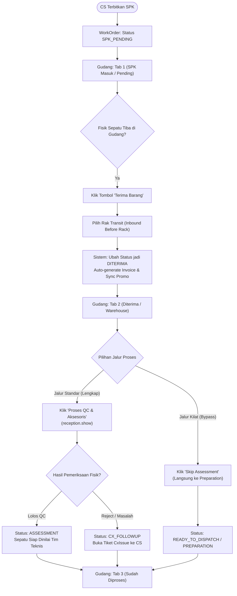

<div class="paper-header">
<div class="paper-badge">DOKUMEN PERANCANGAN SISTEM & PAPER PROJECT</div>
<div class="paper-org">SHOE WORKSHOP INDONESIA • DIVISI IT & DATA ANALYST</div>
<h1 class="paper-title">PERANCANGAN & AUDIT UI/UX MODERN: DIVISI GUDANG (RECEPTION)</h1>
<div class="paper-subtitle">Peningkatan Visual & Kenyamanan Pengguna (UI/UX Ergonomis Mobile-First) Tanpa Mengubah Flow Bisnis & Skema Database</div>
<div class="meta-grid">
<div>
<div class="meta-label">Nomor Dokumen Paper</div>
<div class="meta-val">UIUX-DOC-2026-REC-001 (Rev 2.0)</div>
</div>
<div>
<div class="meta-label">Status Perancangan</div>
<div class="meta-val">✅ Final Approved — Siap Eksekusi (Zero Defect)</div>
</div>
<div>
<div class="meta-label">Divisi Terkait</div>
<div class="meta-val">Divisi Gudang (Reception & Inventory) & Divisi Workshop</div>
</div>
<div>
<div class="meta-label">Lead Architect & Penulis</div>
<div class="meta-val">Sidik Waluya (Full Stack Dev) & Frontend Specialist Lead</div>
</div>
</div>
</div>

</div>

## 1. Eksekutif Ringkasan (Executive Summary)

Divisi Gudang merupakan **pintu gerbang fisik utama (Physical Gatekeeper)** tempat seluruh sepatu dan barang titipan dari pelanggan pertama kali diterima setelah Customer Service (CS) menerbitkan Surat Perintah Kerja (SPK).

Berdasarkan audit mendalam terhadap pola operasional dan arsitektur kode MVC yang ada, halaman utama Penerimaan (`/reception`) memegang peranan krusial bagi produktivitas tim gudang. Pembaruan ini berfokus pada **rekayasa antarmuka visual (UI) dan pengalaman pengguna (UX)** agar operasional harian berjalan jauh lebih cepat, ergonomis di layar ponsel maupun desktop, serta memiliki estetika premium modern tanpa mengubah alur data (*business flow*) yang sudah berjalan dengan stabil.

---


### 1.2 Tujuan Perancangan UI/UX Gudang
Perancangan arsitektur dan sistem ini disusun secara spesifik untuk mencapai sasaran strategis dan operasional bagi **Divisi Gudang (Reception & Inventory) & Divisi Workshop** sebagai berikut:

1. Meremajakan tampilan antarmuka modul penerimaan barang gudang (`/reception`) dengan prinsip UI/UX modern yang mobile-first dan sangat ergonomis.
2. Mempercepat proses unboxing paket kiriman, pencocokan resi ekspedisi, dan alokasi rak sepatu (*Rack Management*) dalam waktu kurang dari 60 detik per resi.
3. Meminimalisir kesalahan identifikasi fisik barang melalui kartu visual informatif, indikator status kontras tinggi, dan tombol aksi sentuh yang nyaman dioperasikan.
4. Mempertahankan keutuhan logika sistem yang sudah ada dengan jaminan 0 perubahan skema database dan 0 mutasi alur backend.

---


## 2. Prinsip & Batasan Utama (Core Principles & Guardrails)

```
┌─────────────────────────────────────────────────────────────────────────────┐
│                       ATURAN MUTLAK PERUBAHAN UI/UX                         │
├─────────────────────────────────────────────────────────────────────────────┤
│ 1. FLOW TIDAK BERUBAH : Status SPK_PENDING -> DITERIMA -> ASSESSMENT /      │
│                         CX_FOLLOWUP tetap berjalan persis seperti semula.   │
│ 2. DATABASE UTUH      : Tidak ada perubahan skema tabel atau kolom baru.    │
│ 3. ROUTE & LOGIC TETAP: Tetap menggunakan method controller & service aktif.│
│ 4. ZERO LATENCY       : Performa pemuatan halaman tetap gesit & ringan.     │
│ 5. INTUITIF & RAMAH   : Tim gudang langsung paham tanpa perlu training baru.│
└─────────────────────────────────────────────────────────────────────────────┘
```

---

## 3. Hasil Audit Kondisi Eksisting vs Solusi Desain Baru

| Area Halaman | Kondisi Sebelumnya (Pain Points) | Solusi Desain Baru (Modern UI/UX) |
| :--- | :--- | :--- |
| **Area Import Excel** | Kotak upload import berukuran sangat besar di paling atas layar, memakan ~40% ruang layar sebelum daftar order terlihat. | Diubah menjadi **Compact Collapsible Toolbar** dengan tombol *"Buka Alat Import & Ekspor"*. Tampilan default langsung memperlihatkan SPK Masuk. |
| **Navigasi Tab** | Tab teks biasa yang rapat di pojok header, tidak menonjolkan urgensi antrian barang masuk. | **Modern Metric Card Tab Bar**: Tab interaktif dengan icon tematik, counter badge dinamis, dan aksen warna spesifik per status. |
| **Filter & Pencarian** | Formulir filter melebar ke banyak kolom dan menghabiskan ruang layar vertikal. | **Smart Filter Bar**: Baris utama berisi pencarian cepat (SPK/Nama/WA) + Quick Priority Chips. Tanggal & filter detail masuk ke panel *Filter Lanjutan*. |
| **Daftar SPK (Desktop)** | Tabel datar standar dengan tombol aksi yang kurang memiliki hirarki visual. | **Elevated Interactive Table**: Baris dengan hover state lembut, badge prioritas ber-dot glow, dan tombol aksi bergradien tegas. |
| **Daftar SPK (Mobile)** | Kartu sederhana dengan tombol aksi standar. | **Premium Mobile Cards**: Kartu modern dengan pemisah visual yang rapi, tombol copy cepat untuk No. SPK dan WhatsApp, serta tombol "Terima Barang" ergonomis. |

<div class="page-break"></div>

## 4. Flowchart Alur Kerja Penerimaan Gudang (Tetap & Preserved)

Flowchart berikut menggambarkan alur operasional gudang yang tetap dipertahankan 100%:



---

<div class="page-break"></div>

## 5. Blueprint Wireframe Antarmuka Baru (`reception/index`)

Berikut adalah visualisasi susunan elemen antarmuka baru:

```
┌───────────────────────────────────────────────────────────────────────────────────┐
│ [📦] GUDANG PENERIMAAN                                                            │
│ RECEPTION & QUALITY CONTROL CENTER                                                │
└───────────────────────────────────────────────────────────────────────────────────┘

┌───────────────────────────────────────────────────────────────────────────────────┐
│ ⚡ TOOLBAR ALAT GUDANG                                                            │
│ [📥 Import Excel ▾]   [📄 Download Template]   [➕ Order Manual]   [🗑️ Tempat Sampah]│
│ (Panel upload tersembunyi rapi secara default dan dapat dibuka dengan 1 klik)    │
└───────────────────────────────────────────────────────────────────────────────────┘

┌───────────────────────────────────────────────────────────────────────────────────┐
│ TAB METRIC TERINTEGRASI:                                                          │
│ ┌────────────────────────┐ ┌────────────────────────┐ ┌────────────────────────┐  │
│ │ 🕒 SPK Masuk (Pending) │ │ 📥 Diterima (Warehouse)│ │ ✅ Sudah Diproses      │  │
│ │     [ 18 Order ]       │ │      [ 42 Order ]      │ │      [ 156 Order ]     │  │
│ │   (Aksen Warm Amber)   │ │  (Aksen Emerald Fresh) │ │   (Aksen Royal Indigo) │  │
│ └────────────────────────┘ └────────────────────────┘ └────────────────────────┘  │
└───────────────────────────────────────────────────────────────────────────────────┘

┌───────────────────────────────────────────────────────────────────────────────────┐
│ 🔍 SMART FILTER & QUICK ACTION:                                                   │
│ [ 🔎 Cari No. SPK, Pelanggan, atau No. WhatsApp...        ] [ Semua | ⚡ Prioritas ]│
│ [ ⚙️ Filter Lanjutan (Tanggal, Status QC) ▾ ] [ 🔄 Reset ] [ 📄 PDF ] [ 📊 Excel ] │
└───────────────────────────────────────────────────────────────────────────────────┘

┌───────────────────────────────────────────────────────────────────────────────────┐
│ DAFTAR ORDER (DESKTOP INTERACTIVE TABLE / MOBILE LUXURY CARDS):                   │
│ ┌───────────────────────────────────────────────────────────────────────────────┐ │
│ │ NO. SPK & CS  │ PELANGGAN      │ BARANG & JASA      │ PRIORITAS │ AKSI CEPAT  │ │
│ ├───────────────┼────────────────┼────────────────────┼───────────┼─────────────┤ │
│ │ S-2610-17-001 │ Budi Santoso   │ Nike Air Jordan 1  │ 🔴 OTO    │ [ Terima ]  │ │
│ │ CS: [FR]      │ 0812-3456-7890 │ Deep Clean + Repaint (Express) │ (Pilih Rak) │ │
│ ├───────────────┼────────────────┼────────────────────┼───────────┼─────────────┤ │
│ │ S-2610-17-002 │ Siti Rahma     │ New Balance 550    │ ⚪ Normal │ [ Terima ]  │ │
│ │ CS: [DW]      │ 0857-1122-3344 │ Unyellowing Sole   │ (Reguler) │ (Pilih Rak) │ │
│ └───────────────────────────────────────────────────────────────────────────────┘ │
└───────────────────────────────────────────────────────────────────────────────────┘
```

---

## 6. Detail Peningkatan UI/UX per Komponen

### A. Compact Tool Panel (Alat Import & Ekspor)
- Menggantikan kotak upload file statis yang besar dengan panel akordeon Alpine.js (`x-data="{ showImport: false }"`).
- Menyediakan tombol cepat: Download Template Excel, Tambah Order Manual, Export Excel, dan Akses Tempat Sampah.
- Menghemat tinggi layar hingga **350 piksel**, sehingga petugas gudang dapat langsung bekerja tanpa harus menggulir (*scrolling*) layar.

### B. Modern Thematic Metric Tabs
- **Tab 1: SPK Masuk (Pending CS)**
  - Warna Utama: Warm Amber (`amber-500` / `#F59E0B`).
  - Indikator: Lingkaran berkedip (*pulse badge*) jika terdapat order belum diterima.
- **Tab 2: Diterima (Warehouse)**
  - Warna Utama: Fresh Emerald (`emerald-600` / `#059669`).
  - Indikator: Menampilkan jumlah sepatu yang sedang berada di rak transit gudang dan siap diperiksa.
- **Tab 3: Sudah Diproses**
  - Warna Utama: Royal Indigo (`indigo-600` / `#4F46E5`).
  - Indikator: Menampilkan riwayat sepatu yang telah dialihkan ke Assessment, Preparation, maupun CX Followup.

### C. Smart Filter Bar & Quick Chips
- **Single Master Search Input**: Pencarian fleksibel langsung mencakup nomor SPK, nama pelanggan, dan nomor WhatsApp.
- **Pintasan Prioritas (Quick Filter Chips)**: Tombol instan satu sentuhan untuk memfilter antara semua order atau order khusus (OTO / Express / Prioritas).
- **Expandable Advanced Filter**: Panel tanggal ("Dari Tanggal" - "Sampai Tanggal" beserta pintasan 14 Hari / 30 Hari) tersimpan rapi dan dapat dibuka-tutup sesuai kebutuhan.

### D. Desain Hibrida: Elevated Table (Desktop) & Luxury Cards (Mobile)
- **Desktop Table**:
  - Kolom terstruktur dengan spasi vertikal yang nyaman di mata.
  - Teks monospace tebal untuk nomor SPK dengan fitur salin cepat (*click-to-copy*).
  - Status prioritas dilengkapi titik bercahaya (*glow dot indicator*).
- **Mobile Cards**:
  - Desain khusus layar sentuh dengan ukuran tombol minimal 44px (standar aksesibilitas Apple/Google).
  - Informasi pelanggan dan spesifikasi sepatu dikelompokkan dalam blok abu-abu lembut (*subtle card*).
  - Tombol aksi utama "Terima Barang" berada di bagian bawah kartu dengan warna aksen kuning keemasan khas Workshop (`#FFC232`).

---

## 7. Rencana Eksekusi & Jaminan Keamanan Kode

1. Pembaruan dilakukan langsung pada file template view:
   - `resources/views/reception/index.blade.php`
2. Seluruh form action (`route('reception.receive')`, `route('reception.import')`, `route('reception.destroy')`, dll.) tetap merujuk ke rute dan controller yang sama.
3. Seluruh atribut nama input formulir (`pending_spk`, `pending_customer`, `pending_priority`, `pending_date_from`, dll.) tetap 100% identik sehingga fungsionalitas controller tidak terganggu.
