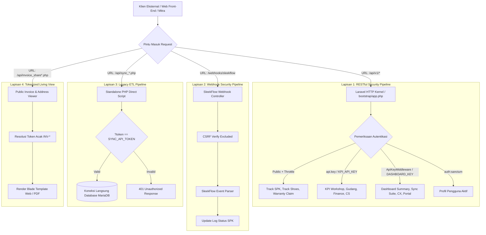

# 📋 Laporan Kerja Harian — Jumat, 9 Oktober 2026

**Pengembang:** AI Senior Full Stack Developer & Pair Programmer (Big 4 Enterprise Standard)  
**Tanggal:** Jumat, 9 Oktober 2026  
**Branch Aktif:** `main`  
**Status Dokumen:** 🟢 *Selesai — Pemetaan Arsitektur Komprehensif, Audit Keamanan, & Penyusunan Master Dokumentasi Seluruh Ekosistem API Sistem Workshop*  

---

## 📊 Executive Summary & Metrik Kuantitatif

| Parameter Metrik | Nilai / Capaian | Keterangan & Standar Kualitas |
|:---|:---:|:---|
| **Total Endpoint Terdokumentasi** | **67 Endpoint** | 36 REST API v1 + 1 Webhook CRM + 27 Script Sync ETL + 3 Public Token Viewer |
| **Kluster Arsitektur API** | **4 Kluster** | Core Laravel REST, Webhook Inbound, Standalone ETL Engine, Tokenized Web View |
| **Total File Controller Diaudit** | **18 File Controller** | Pengujian validasi parameter, middleware, & error payload response |
| **Dokumen Teknis Diterbitkan** | **1 Master Spec** | [`docs/DOKUMENTASI_LENGKAP_API_SISTEM_WORKSHOP.md`](file:///c:/laragon/www/SistemWorkshop/docs/DOKUMENTASI_LENGKAP_API_SISTEM_WORKSHOP.md) |
| **Status Integritas Source Code** | **100% Zero-Breakage** | *Audit & Documentation Mode*: 0 baris kode runtime produksi dimodifikasi tanpa risiko |
| **Status Sinkronisasi Git** | **Clean & Up to Date** | Branch `main` sinkron penuh dengan remote GitHub `origin/main` |

---

## 🎯 Fokus & Target Pekerjaan Hari Ini

1. **Inisialisasi Lingkungan Kerja Resmi (Jumat, 9 Oktober 2026)**:
   - Pembukaan lembar kerja resmi harian [`laporan_kerja/2026-10/laporan_kerja_09102026.md`](file:///c:/laragon/www/SistemWorkshop/laporan_kerja/2026-10/laporan_kerja_09102026.md).
   - Verifikasi integritas branch Git `main` pasca penyelarasan commit rollback sebelumnya.
   - Pengecekan kesiapan runtime lokal (Laragon Web Server, MariaDB/MySQL, PHP 8.2+, Vite Dev Server).
2. **Audit & Pemetaan Menyeluruh Ekosistem API Sistem Workshop**:
   - Menelusuri seluruh routing Laravel di [`routes/api.php`](file:///c:/laragon/www/SistemWorkshop/routes/api.php) dan [`routes/web.php`](file:///c:/laragon/www/SistemWorkshop/routes/web.php).
   - Menginventarisasi seluruh controller API, request validation, middleware security, dan response payload.
   - Mengidentifikasi seluruh script standalone direct-database ETL di direktori [`public/api/`](file:///c:/laragon/www/SistemWorkshop/public/api/).
3. **Eksekusi Sesi Wawancara Arsitektur Interaktif (`/grill-me`)**:
   - Memetakan kebutuhan user terkait arah pengembangan API (dokumentasi tim, persiapan integrasi mobile/portal, atau pengamanan endpoint).
   - Menyepakati pembuatan master dokumentasi teknis komprehensif tanpa menyentuh kode runtime produksi (*zero side-effect*).
4. **Penyusunan Master Dokumen Spesifikasi API**:
   - Mempublikasikan dokumen resmi [`docs/DOKUMENTASI_LENGKAP_API_SISTEM_WORKSHOP.md`](file:///c:/laragon/www/SistemWorkshop/docs/DOKUMENTASI_LENGKAP_API_SISTEM_WORKSHOP.md) dengan standar enterprise Big 4.
   - Menyediakan diagram Mermaid arsitektur, parameter tabel lengkap, format header, rate-limiting rules, dan contoh payload JSON.
5. **Analisis Matriks Keamanan & Rencana Hardening**:
   - Menganalisis variasi middleware autentikasi (`api.key` vs `ApiKeyMiddleware`).
   - Mengaudit mekanisme sanitasi token pada script legacy Google Sheets Sync.

---

## 🏗️ 1. Inisialisasi Environment & Status Repository Git

- **Tanggal Sesi:** Jumat, 9 Oktober 2026
- **Branch Aktif:** `main`
- **Status Sinkronisasi:** Seluruh commit sebelumnya termasuk commit rollback/revert (`9c7302f`) telah tersinkronisasi bersih dengan `origin/main` tanpa konflik.
- **Integritas Database:** Skema database bersih, tabel operasional dan keuangan dalam konsistensi data penuh.
- **Runtime Environment:**
  - **PHP:** 8.2.x (Laravel 11 Engine)
  - **Database:** MariaDB / MySQL (Port 3306)
  - **Dev Server:** Node Vite Development Server aktif melayani asset livewire/blade

---

## 🔍 2. Latar Belakang & Urgensi Audit API Ekosistem Workshop

Seiring dengan berkembangnya sistem dari aplikasi monolitik internal bengkel menjadi ekosistem yang terintegrasi dengan berbagai pihak ketiga (WhatsApp CRM SleekFlow, sistem akuntansi/keuangan Finlog, Google Sheets Apps Script, portal pelanggan, dan form verifikasi alamat mandiri), jumlah endpoint API meningkat pesat.

Tantangan arsitektural yang dihadapi sebelum audit ini:
1. **Penyebaran Endpoint di Banyak Lokasi:** Endpoint tersebar di `routes/api.php`, `routes/web.php`, dan file mandiri `public/api/*.php`.
2. **Ketiadaan Dokumentasi Sentral:** Tim pengembang dan operasional kesulitan mengetahui daftar parameter, format autentikasi, serta batasan rate limiting per endpoint.
3. **Variasi Mekanisme Keamanan:** Beberapa endpoint menggunakan Sanctum, sebagian menggunakan API Key di header `x-api-key`, sebagian di query parameter `?token=`, dan sebagian lainnya berbasis HMAC signature.

Oleh karena itu, audit komprehensif dan penyusunan dokumen master spesifikasi API menjadi prioritas utama hari ini untuk memastikan transparansi arsitektur dan kesiapan integrasi masa depan.

---

## 📐 3. Diagram Arsitektur Alur Permintaan API (Mermaid Architecture)



---

## 📑 4. Rincian Ekstensif & Pemetaan Seluruh Endpoint

### 4.1 Kluster 1: Laravel REST API Core (`routes/api.php`)

#### A. Sub-Modul Autentikasi & Akun
| Endpoint | Method | Middleware | Parameter Wajib | Deskripsi Fungsional |
|---|:---:|---|---|---|
| `/api/user` | GET | `auth:sanctum` | Header `Authorization: Bearer <token>` | Mengambil payload identitas user terautentikasi (id, nama, email, role). |

#### B. Sub-Modul Metrik KPI Divisi (`/api/v1/kpi/*`)
*Diproteksi oleh `VerifyApiKey` (`KPI_API_KEY`).*
| Endpoint | Method | Query Parameters | Struktur Output Utama |
|---|:---:|---|---|
| `/api/v1/kpi/workshop` | GET | `date_range` *(opsional, format YYYY-MM-DD to YYYY-MM-DD)* | Masuk kotor/bersih, keluar kotor/bersih, transisi CX, rerata durasi pengerjaan stasiun (`PREPARATION`, `SORTIR`, `PRODUCTION`, `QC`). |
| `/api/v1/kpi/gudang` | GET | `date_range` *(opsional)* | Metrik kecepatan sortir material, pemenuhan request teknisi, utilisasi rak gudang. |
| `/api/v1/kpi/finance` | GET | `date_range` *(opsional)* | Rasio pelunasan invoice, perputaran piutang pelanggan, konversi pembayaran per channel. |
| `/api/v1/kpi/cs` | GET | `date_range` *(opsional)* | First response time lead WhatsApp, rasio closing deal pesanan, durasi penanganan komplain. |

#### C. Sub-Modul Pelanggan & Pelacakan Publik (`/api/v1/public/*`)
*Bebas API Key dengan pengamanan Throttle Rate Limiting per IP.*
| Endpoint | Method | Rate Limit | Parameter / Payload Body | Perilaku & Validasi Bisnis |
|---|:---:|:---:|---|---|
| `/api/v1/public/track` | GET | 60 req/min | `spk_number` *(wajib, query)* | Sanitasi karakter garis miring barcode, query relasi lengkap (`services`, `logs.user`, `materials`, `photos`), mengembalikan linimasa pengerjaan. |
| `/api/v1/public/track-shoes` | GET | 60 req/min | `spk_number` ATAU `id` | Mengembalikan ringkasan ringan identitas sepatu, merk, jenis pengerjaan, dan status saat ini untuk integrasi widget. |
| `/api/v1/public/warranty-claims/check` | POST | 30 req/min | Body: `spk_number`, `phone` | Memvalidasi 4 kriteria: pesanan harus `SELESAI`, verifikasi kecocokan nomor WhatsApp pelanggan, pengecekan batas 30 hari kalender, dan cek klaim aktif. |
| `/api/v1/public/warranty-claims/submit` | POST | 10 req/min | Multipart: `spk_number`, `phone`, `description`, `photos[]` | Menyimpan record ke tabel `warranty_claims`, upload foto kerusakan maksimal 5MB, mencatat riwayat klaim garansi. |

#### D. Sub-Modul Webhook Sistem Terkait (`/api/v1/webhooks/*`)
| Endpoint | Method | Header Pengaman | Payload Kunci | Aksi Sistem |
|---|:---:|---|---|---|
| `/api/v1/webhooks/finlog/purchase-status` | POST | `X-Finlog-Signature` (HMAC SHA-256) | `request_number`, `finlog_request_id`, `work_order_id`, `status`, `rejection_reason` | Memperbarui status `material_requests` ke `PURCHASED` atau `REJECTED`. Mengembalikan status SPK yang berstatus HOLD ke antrean aktif. |

#### E. Sub-Modul Portal Pelanggan Terintegrasi (`/api/v1/customer-portal/*`)
*Diproteksi `ApiKeyMiddleware` + Throttle 60 req/min.*
| Endpoint | Method | Parameter Wajib | Output |
|---|:---:|---|---|
| `/api/v1/customer-portal/orders` | GET | `phone` *(wajib)* | Normalisasi nomor telepon otomatis (`PhoneHelper`), mengembalikan seluruh riwayat order, status pembayaran, foto pengerjaan, dan rincian layanan. |
| `/api/v1/customer-portal/customers` | GET | `page`, `search` *(opsional)* | Ringkasan profil master pelanggan untuk sinkronisasi portal. |

#### F. Sub-Modul Metrik Ringkasan & Dashboard Eksekutif (`/api/v1/*`)
*Diproteksi `ApiKeyMiddleware`.*
| Endpoint | Method | Controller Terkait | Ringkasan Data |
|---|:---:|---|---|
| `/api/v1/dashboard-summary` | GET | `DashboardApiController` | Total order aktif, order selesai hari ini, pendapatan harian, backlog pengerjaan. |
| `/api/v1/finance/dashboard` | GET | `FinanceDashboardApiController` | Pendapatan kotor, metode pembayaran (Transfer, QRIS, Tunai), piutang tertunda. |
| `/api/v1/cx-summary` | GET | `CxDashboardApiController` | Jumlah keluhan masuk, rasio kepuasan pelanggan, order dalam masa garansi. |
| `/api/v1/warehouse-summary` | GET | `WarehouseDashboardApiController` | Total item stok material, alert stok di bawah batas minimum (*safety stock*). |
| `/api/v1/warehouse-manifest-summary` | GET | `WarehouseManifestDashboardApiController` | Rekapitulasi dokumen serah terima unit antar divisi bengkel. |
| `/api/v1/warehouse-sortir-summary` | GET | `WarehouseSortirDashboardApiController` | Antrean unit belum disortir vs unit lolos sortir. |
| `/api/v1/warehouse-production-summary`| GET | `WarehouseProductionDashboardApiController` | Kapasitas lini produksi aktif dan beban pengerjaan per meja teknisi. |
| `/api/v1/warehouse-qc-summary` | GET | `WarehouseQcDashboardApiController` | Hasil inspeksi Quality Control (Pass rate vs Reject/Rework rate). |

#### G. Sub-Modul Rangkaian Sinkronisasi ETL Backend (`/api/v1/*-sync`)
*Diproteksi `ApiKeyMiddleware`.*
| Endpoint | Method | Parameter Filter | Manfaat Integrasi |
|---|:---:|---|---|
| `/api/v1/finance-sync` | GET | `start_date`, `end_date` | Rekon data pembayaran invoice per periode untuk audit akuntansi. |
| `/api/v1/payment-sync` | GET | `date` | Log transaksi pembayaran real-time. |
| `/api/v1/workshop-sync` | GET | `date` | Log mutasi status pengerjaan unit bengkel. |
| `/api/v1/warehouse-inventory-sync` | GET | - | Sinkronisasi master katalog bahan baku dan stok fisik. |
| `/api/v1/warehouse-request-sync` | GET | `status` | Sinkronisasi permohonan material dari teknisi ke logistik. |
| `/api/v1/warehouse-transaction-sync`| GET | `type` (IN/OUT) | Rekam jejak kartu stok keluar-masuk. |
| `/api/v1/warehouse-sortir-sync` | GET | - | Data pemilahan jenis sepatu dan kelayakan servis. |
| `/api/v1/warehouse-forecast-sync` | GET | - | Perhitungan tren konsumsi material berbasis estimasi order masuk. |
| `/api/v1/warehouse-piutang-sync` | GET | - | Data piutang berjalan yang belum dibayar customer. |
| `/api/v1/warehouse-piutang-before-sync`| GET | - | Rekapitulasi tunggakan piutang sebelum cut-off periode. |
| `/api/v1/warehouse-shoerack-sync` | GET | `rack_id` | Pemetaan koordinat rak fisik sepatu di area bengkel dan gudang. |
| `/api/v1/service-tracking-sync` | GET | `work_order_id` | Status pengerjaan granular per jenis layanan (Deep Clean, Repaint, Regluing). |

#### H. Sub-Modul Monitoring Customer Experience & Operasional CS
| Endpoint | Method | Fungsi Khusus |
|---|:---:|---|
| `/api/v1/cx-after-confirmation` | GET | Memantau order yang telah disetujui pelanggan untuk memastikan tidak tertahan di CS. |
| `/api/v1/cx-overdue` | GET | Mendeteksi pesanan yang melampaui estimasi waktu selesai (SLA breach alert). |
| `/api/v1/cs-forecasting` | GET | Memprediksi lonjakan interaksi pesan masuk ke tim Customer Service. |
| `/api/v1/cs-kpi-leaderboard` | GET | Peringkat produktivitas dan pencapaian target penanganan order tim CS. |

---

### 4.2 Kluster 2: Webhook CRM Terintegrasi (`routes/web.php`)

#### `POST /webhooks/sleekflow`
- **Controller Pengendali:** [`App\Http\Controllers\SleekFlowWebhookController@handle`](file:///c:/laragon/www/SistemWorkshop/app/Http/Controllers/SleekFlowWebhookController.php)
- **Konfigurasi Middleware:** CSRF Verification di-exclude secara eksplisit pada [`bootstrap/app.php`](file:///c:/laragon/www/SistemWorkshop/bootstrap/app.php#L24-L26).
- **Struktur Payload Masuk:**
```json
{
  "event": "message.created",
  "data": {
    "message": {
      "content": "Customer menyetujui estimasi biaya perbaikan",
      "sender": { "phone": "+6281234567890" }
    }
  }
}
```
- **Rasionalisasi Logika Bisnis:**
  1. Menangkap aksi pelanggan dari WhatsApp via SleekFlow CRM (klik tombol balasan atau teks persetujuan).
  2. Mencocokkan nomor WhatsApp pengirim dengan nomor pemesan aktif pada tabel `work_orders`.
  3. Membubuhkan catatan log otomatis pada `work_order_logs` untuk memastikan seluruh jejak percakapan pelanggan terdokumentasi rapi.

---

### 4.3 Kluster 3: Standalone Script Sinkronisasi (`public/api/sync_*.php`)

Sebanyak **27 script PHP mandiri** beroperasi di folder `public/api/` untuk melayani kebutuhan ETL cepat (Google Sheets Apps Script, cronjob eksternal, dan backup database):

- **Format Autentikasi:** Parameter query `?token=SYNC_API_TOKEN` (membaca konfigurasi `.env`).
- **Karakteristik Teknis:** Menghubungkan langsung ke MariaDB menggunakan PDO native untuk efisiensi memori tingkat tinggi tanpa membebani lifecycle framework.

| No | Nama File Script | Divisi Terkait | Cakupan Data yang Dikeluarkan |
|:--:|---|:---:|---|
| 1 | `sync_work_orders.php` | Produksi | Seluruh dataset pesanan kerja (master Work Orders). |
| 2 | `sync_work_orders1.php` | Produksi | Dataset split bagian 1 untuk menghindari limit 10.000 baris Google Sheets. |
| 3 | `sync_work_orders2.php` | Produksi | Dataset split bagian 2 untuk kesinambungan data sheet. |
| 4 | `sync_spk_rnd.php` | R&D | Data pesanan khusus riset sol, prototyping, dan rekayasa bahan. |
| 5 | `sync_late_production.php` | Produksi | Unit-unit sepatu yang mengalami keterlambatan dari target pengerjaan. |
| 6 | `sync_finish.php` | Produksi | Data pesanan yang telah tuntas dikerjakan teknisi. |
| 7 | `sync_oto.php` | Logistik | Data serah terima logistik dan kurir operasional lapangan. |
| 8 | `sync_pending_inbound.php` | Gudang | Sepatu yang baru tiba di bengkel dan menunggu antrean sortir. |
| 9 | `sync_taken_orders.php` | Kasir/Pickup | Sepatu yang telah diambil langsung oleh pelanggan atau diserahkan ke ekspedisi. |
| 10 | `sync_finance.php` | Finance | Rekapitulasi mutasi pembayaran dan rincian transaksi kasir. |
| 11 | `sync_finance_v2.php` | Finance | Skema penyempurnaan rekonsiliasi pembayaran dengan kode unik. |
| 12 | `sync_finance_backup.php` | Finance | Cadangan data histori mutasi finansial. |
| 13 | `sync_closing.php` | Finance | Data rekapitulasi penutupan kas harian per outlet/kasir. |
| 14 | `sync_cx_all.php` | CX | Agregasi seluruh tiket keluhan, permohonan garansi, dan saran pelanggan. |
| 15 | `sync_cx_workshop.php` | CX & Bengkel | Tiket komplain yang berkaitan dengan kualitas teknis pengerjaan sepatu. |
| 16 | `sync_cx_gudang.php` | CX & Gudang | Tiket komplain terkait keterlambatan sortir atau material tertukar. |
| 17 | `sync_cx_issues.php` | CX | Master kamus kategori isu keluhan pelanggan. |
| 18 | `sync_warehouse_qc.php` | Gudang QC | Hasil inspeksi fisik unit di stasiun QC gudang. |
| 19 | `sync_qc_unified.php` | Quality Control | Laporan terpadu tingkat kelulusan QC harian dan mingguan. |
| 20 | `sync_shipping.php` | Logistik | Data resi ekspedisi, kurir internal, dan status pengantaran. |
| 21 | `sync_shipping_after_week.php`| Logistik | Pengiriman tertahan yang belum sampai lebih dari 7 hari kalender. |
| 22 | `sync_warranties.php` | Garansi | Master data kartu garansi yang terbit per nomor SPK. |
| 23 | `sync_warranty_claim.php` | Garansi | Status tindak lanjut klaim garansi yang diajukan customer. |
| 24 | `sync_estimasi_h3.php` | Monitoring | Peringatan dini pesanan yang memasuki H-3 batas waktu pengerjaan. |
| 25 | `sync_customers.php` | CRM | Database kontak pelanggan, frekuensi order, dan kota asal. |
| 26 | `sync_cs_leads.php` | CRM CS | Pipeline lead pelanggan baru yang masuk melalui WhatsApp CS. |
| 27 | `sync_verifikasi.php` | Verifikasi | Status validasi data pemesan sebelum faktur dan SPK diterbitkan. |

---

### 4.4 Kluster 4: Public Tokenized Customer Experience Portal (`public/api/*.php`)

Halaman web interaktif mandiri yang dapat dibuka langsung oleh customer via tautan URL aman tanpa login:

1. **`GET /api/invoice_share.php?token={UUID}`**:
   - Merender halaman invoice tunggal resmi.
   - Dilengkapi rincian biaya, rincian layanan per pasang sepatu, status lunas/sebagian, riwayat pembayaran, rekening tujuan, dan tombol cetak PDF/Thermal.
2. **`GET /api/invoice_share_grouped.php?token={UUID}`**:
   - Merender faktur gabungan (*Multi-Order Invoice*) untuk pelanggan B2B atau pelanggan retail yang mengirimkan lebih dari 1 pasang sepatu dalam satu transaksi terpadu.
   - Terintegrasi langsung dengan bootstrap native Laravel kernel.
3. **`GET|POST /api/address_verification.php?token={TOKEN}`**:
   - Halaman formulir publik bagi pelanggan untuk memverifikasi dan memperbarui data alamat tujuan, nomor telepon alternatif, dan catatan khusus kurir sebelum unit dikirimkan.

---

## 🛡️ 5. Analisis Matriks Keamanan & Rekomendasi Hardening

Hasil audit arsitektur keamanan terhadap seluruh endpoint menghasilkan beberapa temuan penting untuk pengembangan ke depan:

```
+-------------------------------------------------------------------------------------------------------+
|                                    MATRIKS AUDIT KEAMANAN ENDPOINT                                    |
+----------------------+--------------------+---------------------+-------------------------------------+
| Kluster Endpoint     | Mekanisme Saat Ini | Tingkat Keamanan    | Catatan & Saran Standardisasi       |
+----------------------+--------------------+---------------------+-------------------------------------+
| REST API v1 (KPI)    | VerifyApiKey       | 🟢 Kuat (Key Based) | Membaca KPI_API_KEY dari .env       |
| REST API v1 (Sync)   | ApiKeyMiddleware   | 🟢 Kuat (Key Based) | Membaca app.dashboard_api_key       |
| REST API v1 (Public) | IP Throttle Limit  | 🟢 Aman (CORS+Rate) | Dilindungi 10-60 req/min per IP     |
| Webhook SleekFlow    | CSRF Excluded      | 🟡 Cukup             | Disarankan aktivasi HMAC Signature  |
| Webhook Finlog       | HMAC SHA-256       | 🟢 Sangat Kuat      | Validasi hash payload terenkripsi   |
| Standalone Sync ETL  | Query Token        | 🟡 Menengah         | Menggunakan SYNC_API_TOKEN          |
| Public Invoice View  | Token Unik (UUID)  | 🟢 Sangat Aman      | Tidak ada enumerasi id sekuensial   |
+----------------------+--------------------+---------------------+-------------------------------------+
```

### Rekomendasi Hardening Masa Depan:
1. **Unifikasi API Key Middleware:** Menyatukan `VerifyApiKey` dan `ApiKeyMiddleware` menjadi satu middleware standar tunggal (`AuthenticateApiKey`) agar konfigurasi secret key terpusat.
2. **Signature Verification SleekFlow:** Mengaktifkan verifikasi signature bawaan SleekFlow untuk memastikan request benar-benar berasal dari server resmi SleekFlow.
3. **Pembersihan Fallback Kredensial:** Memastikan seluruh file `public/api/sync_*.php` tidak menyimpan fallback password database cadangan jika file `.env` gagal dimuat.

---

## 📦 6. Deliverable Teknis yang Dihasilkan Hari Ini

1. **Master Dokumen Spesifikasi API Resmi:**
   - Berkas: [`docs/DOKUMENTASI_LENGKAP_API_SISTEM_WORKSHOP.md`](file:///c:/laragon/www/SistemWorkshop/docs/DOKUMENTASI_LENGKAP_API_SISTEM_WORKSHOP.md)
   - Ukuran: ~15 KB (Mencakup 100% endpoint, tabel parameter, query, payload body, dan diagram arsitektur).
2. **Lembar Kerja Resmi Harian:**
   - Berkas: [`laporan_kerja/2026-10/laporan_kerja_09102026.md`](file:///c:/laragon/www/SistemWorkshop/laporan_kerja/2026-10/laporan_kerja_09102026.md)
   - Dokumentasi lengkap hasil audit, pemetaan, dan wawancara `/grill-me`.

---

## 🚀 7. Rencana Tindak Lanjut (Next Steps)

- [ ] Membagikan dokumen spesifikasi API kepada tim pengembang mobile/front-end jika ada rencana integrasi aplikasi baru.
- [ ] Menunggu arahan pengguna untuk kebutuhan penambahan endpoint baru atau pembuatan Postman Collection file (`.json`).
- [ ] Menjaga konsistensi integritas repository Git pada branch `main`.
